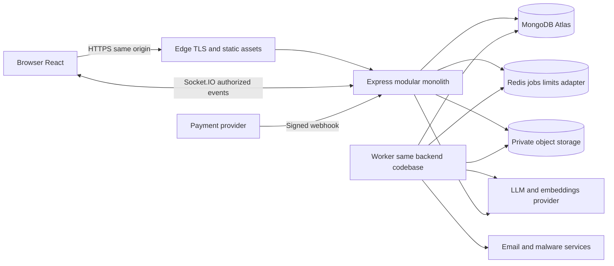
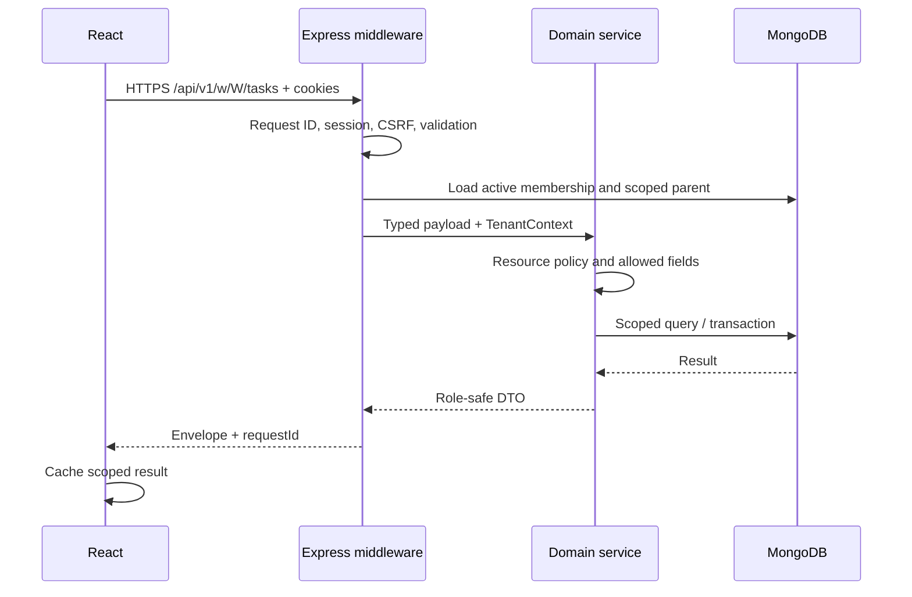
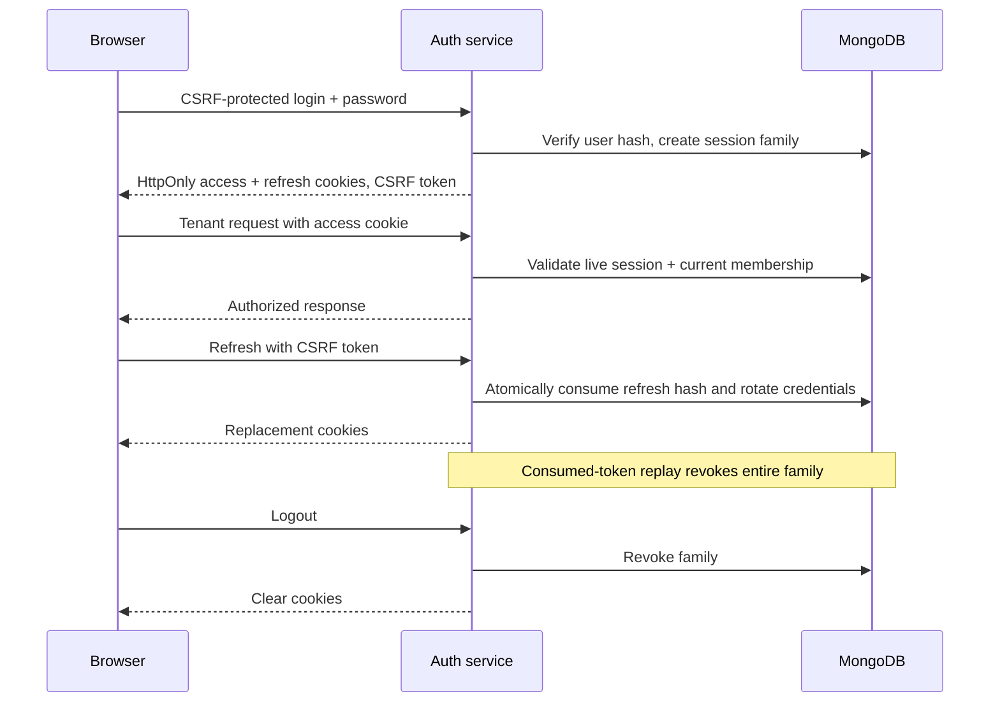
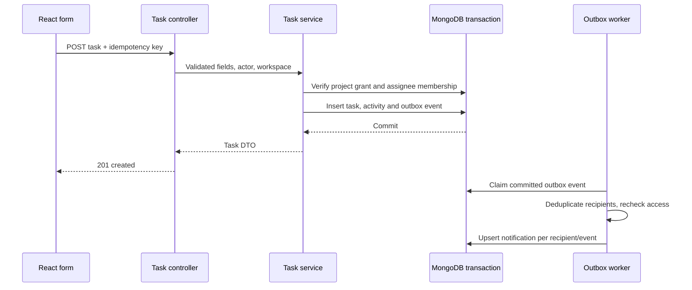
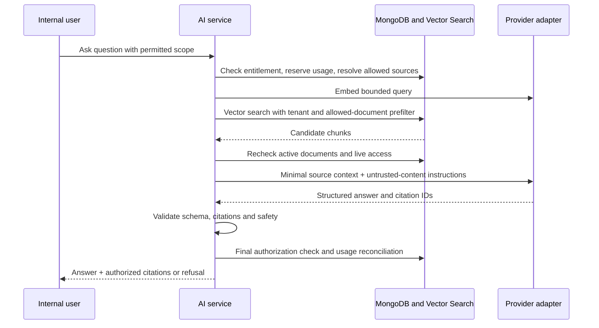

# 03 · System architecture

Status: historical Phase 1 topology, with HTTP/auth/tenant modules now implemented through Phase 5. See the Phase 5 runtime addendum and architecture for current behavior; worker, sockets, storage and AI sections remain plans. No production deployment is claimed.

## Boundaries and stack

The React/Vite frontend uses TypeScript, Tailwind CSS, shadcn/ui on Radix UI, Lucide icons, React Router, TanStack Query, Zustand, React Hook Form and Zod. Express/Node.js exposes REST `/api/v1` and Socket.IO. Mongoose persists to MongoDB Atlas. A private S3-compatible bucket holds binaries; MongoDB holds metadata. Redis is the proposed supporting queue, distributed limit and Socket.IO adapter store, not a domain microservice. Use a maintained Redis-backed Node job library selected in Phase 3 and lock its version after review. One bounded worker process initially handles email, scanning orchestration, extraction, embeddings, outbox dispatch and deletion jobs with separate concurrency limits.

Docker/Compose will provide repeatable development processes; GitHub Actions will lint, typecheck, test and build. Production requires managed persistence, secrets, TLS termination and a transactional MongoDB deployment. Local replica-set MongoDB supports transactions; real Vector Search integration is tested against a separate isolated Atlas environment. Do not imply a plain local MongoDB container provides the same vector capabilities.



Trust boundaries: browser and uploaded documents are untrusted; edge-to-API requires authenticated application policy, not network trust; managed database/storage/queue use restricted credentials; third-party AI/payment/email providers receive only necessary data. The worker is privileged but has no implicit authority to act on behalf of a removed user.

## Planned repository organization

Future layout, not created in Phase 1:

```text
frontend/src/{app,routes,features,components,lib,styles}
backend/src/{bootstrap,config,http,realtime,workers,shared}
backend/src/modules/{auth,users,workspaces,members,clients,projects,tasks,
  milestones,attachments,tickets,notifications,knowledge,ai,analytics,billing,audit}
packages/contracts/       transport Zod schemas and DTO types, no database code
infra/                   Docker, Compose, deployment templates
```

Each module owns routes → controller → service → repository/model. Middleware handles request ID, bounded parsing, authentication, CSRF, validation and tenant context. Services own transactions, permissions, business invariants and outbox writes. Repositories require an explicit TenantContext except clearly named global repositories (users, sessions, plans and webhook event intake). Do not rely solely on Mongoose query hooks: raw queries, aggregations and worker paths also need scope. Modules call another module's service interface, never reach into its Mongoose model from arbitrary controllers. Shared code is limited to errors, pagination, auth context, logging and transport primitives.

## Frontend state and navigation

Public routes: `/`, `/pricing`, `/signup`, `/login`, `/forgot-password`, `/reset-password`, `/verify-email`. Signed-in account routes: `/onboarding`, `/workspaces`, `/account`. Internal workspace shell: `/w/:workspaceId/{dashboard,team,clients,projects,tickets,notifications,ai,knowledge,analytics,settings,billing}`. Projects nest `/projects/:projectId/{overview,board,milestones}` and `/tasks/:taskId` supports a drawer with a full-page fallback. Client shell: `/w/:workspaceId/portal/{dashboard,projects,tickets,notifications}`. Deep links always refetch and authorize. Router guards improve UX but supply no security boundary.

TanStack Query owns remote entities, stale state, background fetch and mutation reconciliation. Query keys include principal, workspace, resource, filter and access revision. Start with 30-second stale time for lists, immediate invalidation after successful writes, no automatic retry for 401/403/404/409/422 and at most two jittered retries on safe transient reads. Never replay financial writes automatically without idempotency. Zustand stores sidebar, command palette and transient panel state only. Forms use React Hook Form/Zod; backend Zod remains authoritative. No tokens or sensitive server snapshots in localStorage. On workspace switch abort pending requests, clear previous workspace queries and sockets, render an interstitial, then fetch new context.

## HTTP lifecycle



Errors map to stable domain codes; unknown exceptions become 500 with requestId and no stack in the response. Validation errors contain field paths, not database internals. Mongoose duplicate keys become 409. Database failures produce 503 when recoverable; timeouts have bounded budgets and no ambiguous automatic mutation retry. Structured JSON logs include service, requestId, route template, duration, status and pseudonymous actor/workspace IDs. Redact cookies, authorization, token strings, prompts, documents, payment payloads and personal text.

## Authentication lifecycle

Use opaque random access credentials (15-minute candidate lifetime) and rotating opaque refresh credentials (7-day idle, 30-day absolute session-family limit). Only token hashes are stored. Cookie details and CSRF are in document 08. Access credentials map to a live session family; membership is resolved separately on every tenant action. These are proposed lifetimes for security review, not implemented settings.



Refresh rotation uses compare-and-swap and consumed-token history (document 04). Tabs coordinate refresh via BroadcastChannel and a single-flight leader. A conflicting/replayed consumed token fails closed and may require re-login; do not weaken replay detection with indefinite grace periods.

## Task transaction and durable side effects



Transactions are short, with no network calls to storage/AI/email. Unique idempotency constraints prevent double creates. A committed DB write must not be reported as rolled back merely because socket publishing fails. Outbox delivery is at least once, consumers deduplicate, and failed jobs are retried with exponential backoff then dead-lettered for inspection. Operational collections are defined in document 04.

## Socket.IO lifecycle

```mermaid
sequenceDiagram
  participant B as Browser
  participant S as Socket gateway
  participant A as Express API
  participant D as Membership and notifications
  participant W as Worker
  B->>S: Connect with cookies + approved Origin
  S->>D: Validate session and membership
  S->>S: Join derived user/workspace/project rooms
  W->>D: Persist authorized notification
  W->>S: Publish notification.available with ID
  S-->>B: eventId, workspaceId, entityId, version
  B->>A: HTTP reconciliation request
  A->>D: Scoped inbox and resource reads
  D-->>A: Current authorized records
  A-->>B: Safe DTOs and cursor
  Note over B,S: Reconnect may miss events; refetch from durable cursor
```

Room names are derived server-side (`w:W:u:U`, `w:W:p:P`) and never accepted from a client. Client sockets receive only user-specific safe notification hints; no internal project broadcasts. Mutations use REST at launch; socket messages cover subscriptions and presence only. Membership is checked at connection, each subscription/message and before dispatch of protected events. On reconnect always reauthorize and reconcile; adapter recovery cannot substitute for policy.

Events: `task.changed`, `project.changed`, `ticket.changed`, `notification.available`, `membership.revoked`, each with `eventId`, `workspaceId`, `resourceId`, `version`, `occurredAt`, no internal body. Ignore duplicate/stale versions and invalidate appropriate queries. Socket.IO default delivery is at-most-once, so durable notification records and REST resync are mandatory ([official delivery guarantees](https://socket.io/docs/v4/delivery-guarantees/)). Redis adapter selection must be checked for recovery support before promising resumable delivery.

## AI and RAG lifecycle



Ingestion: authorized upload → clean scan → bounded parser → chunk with source offsets → embed through adapter → write versioned chunks → mark document ready after index visibility probe. Queue concurrency prevents provider overload. Retrieval always uses `workspaceId`, active document generation and server-derived allowed document IDs; never search globally then filter as the primary isolation mechanism. Vector index filter fields must be configured explicitly ([MongoDB prefilter documentation](https://www.mongodb.com/docs/vector-search/query/aggregation-stages/vector-search-stage/)). Large ACL sets are bounded; refuse or partition safely rather than omit filters. Recheck live source ACLs after approximate/indexed search because indexes may lag. Details in document 08.

The adapter exposes `generate`, `embed`, timeout/cancellation, model metadata, structured output and usage. Provider choice and embedding dimension are configuration choices pinned per index generation. Reject invalid output; do not expose provider errors verbatim. Launch AI tools are read-only; drafts return text and cannot execute changes. Future writes require a displayed exact action, human confirmation, authorization on execution, idempotency and audit.

## Storage, jobs and failure handling

API reserves attachment record and random key under workspace/parent prefix → returns constrained short-lived upload URL → finalize verifies size/type/checksum with storage → worker scans → clean status enables separately authorized downloads. Reject MIME spoofing, archives initially, executable types and oversized parsing. No public buckets. Ingestion references clean attachment ID; document removal immediately revokes retrieval before queued binary/chunk purge.

| Failure | Required behavior |
|---|---|
| Redis unavailable | Core writes may commit with outbox; realtime delayed; queue-producing flows return accepted only if durably recorded; rate limits fail closed for auth/AI |
| Worker crashes after side effect | Retry with provider idempotency where available; dedupe local records; reconcile ambiguous outcomes |
| Atlas unavailable | 503, no writes or authorization from stale browser state |
| Vector index lag | Show indexing state; bounded retry, never broaden scope |
| LLM timeout/outage | Clear unavailable response, release unused reservation, keep non-AI work functional |
| Payment webhook delayed/out-of-order | Preserve paid-through entitlement, reconcile provider object version; no unconditional “last event wins” |
| Storage scan outage | Keep pending/quarantined; no download or extraction |
| Access revoked mid-request | Final check for AI/download; optimistic concurrency and short transactions for writes; record residual in-flight exposure limits |

## Scaling and trade-offs

Start one API process and one worker. Scale stateless API replicas behind an edge; Socket.IO polling requires sticky routing and a compatible distributed adapter. Split worker queues by latency/security risk, constrain provider calls, and index measured query paths. Redis caches are optional accelerators, never authorization truth. Cap pagination, input bodies, exports and AI context; analytics uses scoped aggregation initially, materialized summaries only when measured need arises.

A modular monolith provides local transactions, simpler debugging, lower operating cost and explicit code boundaries while the domain is changing. It shares failure/deploy boundaries; background workloads need resource isolation. Microservices would add distributed consistency, authentication and operational complexity before evidence of need. Extract a domain only after independently measured scaling, ownership or compliance requirements justify it. Kubernetes is outside MVP scope.

## Phase 5 runtime addendum

The implemented shared-database tenant parent is Organization, containing Workspace. Current database membership authorizes every tenant endpoint; writes reauthorize in MongoDB transactions and serialize membership changes through an organization guard. The frontend real `/app` shell has user/workspace-scoped query state; the public demo remains independent. See [Phase 5 architecture](phase-5-multi-tenant-architecture.md) for six runtime diagrams and rollout constraints. Live business acceptance is pending credential rotation and additive tenant schema initialization. No projects/tasks, sockets, uploads or AI persistence has been added.
