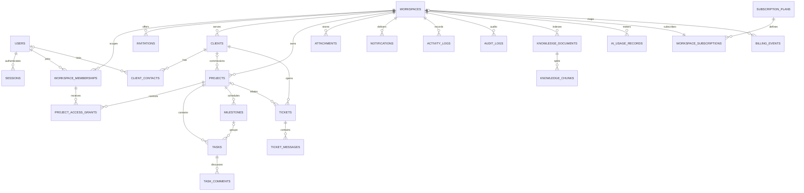

# 04 · Database design

Status: proposed Mongoose schema contracts, not executable models or an initialized database.

## Shared schema conventions

All collections use `_id: ObjectId!`, `createdAt: Date!`, `updatedAt: Date!` (UTC) and explicit schema validation. `!` marks required fields; `?` optional, `[]` bounded arrays; Ref means ObjectId reference, not an enforced database foreign key. All tenant collections require immutable `workspaceId: Ref<workspaces>!`, indexed through access patterns. Exceptions are explicitly labeled global below. Tenant fields cannot be supplied as mutable body properties. `version: integer!` starts at 1 on mutable domain entities and is checked in updates.

Every tenant reference is validated with `{_id: ref, workspaceId: currentWorkspace}` plus parent/role constraints. Mongoose `ref` and `populate` alone do not enforce this. Repositories must scope both aggregation and populate matches and project safe fields. Use transactions for invariants spanning documents. MongoDB unique indexes enforce local uniqueness but cannot enforce cross-collection tenant equality. No multi-tenant reference is accepted solely because an ObjectId is well formed.

Default validation: trim and normalize human labels, name 1–120 characters, title 1–240, text body ≤20,000 characters, email normalized with a documented case policy, URL limited to safe protocols, finite integers with bounds, explicit enum values, reject unknown mutation fields. Do not permit arbitrary MongoDB operators/regex from user input. Record text as plain text/limited sanitized markup; no stored executable HTML.

Unless overridden, timestamps are Mongoose `timestamps: true`; indexes below include implicit unique `_id`. “U” means unique and “P” partial. Define indexes in migrations, review query plans and build production indexes deliberately; no uncontrolled startup auto-indexing. Lists use `{createdAt:-1,_id:-1}` cursor order unless specified. Retention values are proposed defaults to approve before production, not legal advice. Deletion deadlines include asynchronous purge verification and backup expiry, not instantaneous erasure from backups.

## Collection contracts

### users — global identity

- Purpose: one identity can belong to several workspaces. Fields: `emailNormalized: string!`, `displayName: string!`, `passwordHash: string!` (excluded from default selects), `emailVerifiedAt: Date?`, `status: active|disabled|deletion_pending!`, `avatarAttachmentId: Ref?`, `passwordChangedAt: Date?`, `version: int!`.
- Validation/references: verified address required before workspace creation/invite acceptance. Avatar must be owned account asset, not an arbitrary tenant file. MVP can omit avatars until global attachment ownership is supported; initials are the default.
- Isolation: global; self-profile DTO only. Workspace lists expose membership-approved summaries, not the global directory.
- Indexes: U `{emailNormalized:1}`. Delete: disable/revoke sessions, resolve ownership in every workspace, anonymize authored-display references where possible. Proposed purge after 30-day recovery, retain audit pseudonymous ID under separate policy. Both timestamps required.

### sessions — global credential family ledger

- Purpose: revocable browser/device session. Fields: `userId: Ref<users>!`, `familyId: UUID!`, `status: active|revoked!`, `accessHash: string!`, `accessExpiresAt: Date!`, `currentRefreshHash: string!`, `usedRefreshHashes: [{hash,consumedAt,expiresAt}]!`, `idleExpiresAt: Date!`, `absoluteExpiresAt: Date!`, `purgeAt: Date!`, `lastSeenAt: Date!`, `revokedAt: Date?`, `deviceLabel: string?`.
- Validation: cryptographically random secrets; store hashes only, never token plaintext. Used hashes persist until family absolute expiry to detect old-token replay; bounded by refresh rate and 30-day family lifetime. Rotation is one atomic compare-and-swap updating access/refresh and used history; overflow revokes family and requires login. No unbounded client-provided arrays.
- Isolation: global session authenticates identity; never stores authoritative workspace role. Indexes: U `{familyId:1}`, U `{accessHash:1}`, U `{currentRefreshHash:1}`, `{userId:1,status:1}`, `{usedRefreshHashes.hash:1}`, TTL `{purgeAt:1}`. TTL cleanup is delayed; all expiry checks occur in code.
- Deletion/retention: immediate logical revocation; purge 7 days after absolute expiry/revocation subject to security investigation policy. Both timestamps required.

### workspaces — tenant root and concurrency guard

- Purpose: Tenant identity, settings and shared concurrency/quota guard.
- Fields: `name: string!`, `slug: string!`, `createdBy: Ref<users>!`, `creationKey: string!`, `creationDigest: string!`, `status: active|suspended|deletion_pending!`, `ownerCount: int!`, `authzRevision: int!`, `settings: {timezone,locale,brandName}!`, `deletionRequestedAt: Date?`, `version: int!`.
- Validation: slug lowercase `[a-z0-9-]`, 3–63; ownerCount ≥1 while active; timezone from allowed IANA identifiers. Settings bounded, no secrets. `_id` is tenant key; no workspaceId self-reference.
- Bounded quota fields: `usageCounters: {activeStaffSeats:int!,activeClientContacts:int!,reservedStorageBytes:int!,storedStorageBytes:int!}!`, all nonnegative. Membership/contact creation/removal updates counters with workspace conditional guard and current plan limit in the same transaction. Invitations do not reserve seats at launch; acceptance may fail with 409 `SEAT_LIMIT_REACHED`. Upload reservation/finalize/abandon/delete transitions adjust storage counters atomically with attachment state; a periodic scoped reconciliation detects drift. No quota counter can grant authorization.
- Indexes: U `{slug:1}`, U `{createdBy:1,creationKey:1}`, `{status:1,createdAt:-1}` for restricted operations. Ownership transaction writes this guard and memberships together (document 02). Workspace creation uses creationKey/digest to return the same safe result on retry or 409 on changed payload.
- Delete: Owner reauth and confirmation, suspend writes immediately, orchestrate 30-day recovery then purge children and bucket keys. Backups age out within configured window. Both timestamps required.

### workspaceMemberships — identity-to-tenant role

- Purpose: Bind a global user to one tenant role and optional client account.
- Fields: `workspaceId!`, `userId: Ref<users>!`, `role: Owner|Admin|Manager|Member|Client!`, `status: active|removed!`, `clientId: Ref<clients>?`, `joinedAt: Date!`, `removedAt: Date?`, `version: int!`.
- Validation: Client requires same-workspace clientId and matching active contact; staff must have no clientId. Reactivating a removed row revalidates grants; no implicit restoration. One role per user/workspace.
- Indexes: U `{workspaceId:1,userId:1}`, `{workspaceId:1,status:1,role:1}`, `{userId:1,status:1}` for authorized switcher.
- Delete: logical removal, revoke grants and increment workspace authzRevision; retain minimal membership reference 12 months for audit, then anonymize if policy permits. Both timestamps required.

### invitations — single-use membership offers

- Purpose: Issue email-bound expiring membership offers without granting access before acceptance.
- Fields: `workspaceId!`, `emailNormalized: string!`, `role: enum!`, `clientId: Ref<clients>?`, `tokenHash: string!`, `status: pending|accepted|revoked|expired!`, `invitedBy: Ref<users>!`, `expiresAt: Date!`, `acceptedBy: Ref<users>?`, `purgeAt: Date!`.
- Validate issuer capability, client-role relation, verified matching email at acceptance and active expiry (7-day candidate). Transaction creates/reactivates membership and consumes invite. Expired rows are marked expired before reissue.
- Indexes: U `{tokenHash:1}`, U P `{workspaceId:1,emailNormalized:1}` where status=pending, `{workspaceId:1,status:1}`, TTL `{purgeAt:1}`. Retain consumed/revoked 90 days, then purge; expired pending records are not accepted even before TTL. Both timestamps required.

### clients — workspace customer accounts

- Purpose: Represent an agency customer account and its internal administrative profile.
- Fields: `workspaceId!`, `name: string!`, `status: active|archived!`, `website: string?`, `billingEmail: string?`, `notes: string?` (internal), `createdBy: Ref<users>!`, `version: int!`.
- Validation: bounded notes; name is not unique. Owner/Admin mutate. Indexes: `{workspaceId:1,status:1,name:1,_id:1}`. Archive prevents new work/invites; existing public grants remain only if explicitly retained. Hard purge blocked while active projects/tickets exist; remove with workspace lifecycle or approved client erasure plan. Default archive retention 12 months, review data minimization. Both timestamps required.

### clientContacts — customer people and identity linkage

- Purpose: Represent people at a client and optionally link their verified global identity.
- Fields: `workspaceId!`, `clientId: Ref<clients>!`, `emailNormalized: string!`, `name: string!`, `userId: Ref<users>?`, `status: active|archived!`, `version: int!`.
- Validation: linked user must have matching verified email and Client membership for same client; one Client identity per workspace is an MVP limit. A contact row alone grants no login access.
- Indexes: U `{workspaceId:1,clientId:1,emailNormalized:1}`, U P `{workspaceId:1,userId:1}` for ObjectId userId only; `{workspaceId:1,clientId:1,status:1}`. Archive linked contacts removes client membership/grants transactionally. Retain minimal identity through outstanding tickets then proposed 12 months; erasure anonymizes. Both timestamps required.

### projects — delivery containers

- Purpose: Group agency delivery work and provide a parent visibility boundary.
- Fields: `workspaceId!`, `clientId: Ref<clients>?`, `name: string!`, `description: string?`, `status: planned|active|paused|completed|archived!`, `clientVisible: boolean!` default false, `createdBy: Ref<users>!`, `dueAt: Date?`, `deletedAt: Date?`, `version: int!`.
- Validation: public project requires a client; changing client with existing published content/grants is blocked in MVP. Creator Manager gets manager grant in same transaction.
- Indexes: `{workspaceId:1,status:1,createdAt:-1,_id:-1}`, `{workspaceId:1,clientId:1,clientVisible:1}`. Soft delete immediately denies children; purge children after 30 days recovery, retention subject to workspace policy. Both timestamps required.

### projectAccessGrants — bounded project ACL rows

- Purpose: Grant a workspace membership explicit scoped access to a project.
- Fields: `workspaceId!`, `projectId: Ref<projects>!`, `membershipId: Ref<workspaceMemberships>!`, `accessRole: manager|contributor|viewer!`, `status: active|revoked!`, `grantedBy: Ref<users>!`, `version: int!`.
- Validate membership active; manager grant requires Manager workspace role (Owner/Admin do not need grants); Member only contributor; Client only viewer with project.clientId matching membership.clientId. All references same workspace.
- Indexes: U `{workspaceId:1,projectId:1,membershipId:1}`, `{workspaceId:1,membershipId:1,status:1}`. Revoke immediately; project/membership purge cascades rows. Retain revoked 90 days unless security policy requires longer. Both timestamps required.

### tasks — units of work and board cards

- Purpose: Track actionable work, board state, assignment and reviewed client publication.
- Fields: `workspaceId!`, `projectId: Ref<projects>!`, `title: string!`, `description: string?` (internal), `publicSummary: string?` (client text, ≤20,000 chars), `status: backlog|todo|in_progress|review|done!`, `priority: low|normal|high|urgent!`, `assigneeMembershipId: Ref?`, `createdBy: Ref<users>!`, `milestoneId: Ref?`, `dueAt: Date?`, `rank: string!`, `clientVisible: boolean!` default false, `deletedAt: Date?`, `version: int!`.
- Validate active assignee has same-project internal grant or Owner/Admin membership. Milestone must match project/workspace. Publication requires nonempty publicSummary and review of shared title/dates. Rank server-generated bounded lexical rank; rebalance in bounded transaction/job, break ties with `_id`. No embedded unbounded comments.
- Indexes: `{workspaceId:1,projectId:1,status:1,rank:1,_id:1}`, `{workspaceId:1,assigneeMembershipId:1,status:1,dueAt:1}`, `{workspaceId:1,projectId:1,createdAt:-1,_id:-1}`. Soft delete 30-day recovery then purge comments/attachments references; completed tasks retained while project active. Both timestamps required.

### taskComments — visibility-aware discussion

- Purpose: Store independently paginated task conversation with explicit visibility.
- Fields: `workspaceId!`, `projectId: Ref!`, `taskId: Ref<tasks>!`, `authorId: Ref<users>!`, `body: string!`, `visibility: internal|client!`, `editedAt: Date?`, `deletedAt: Date?`, `version: int!`.
- Validate author can read parent; client/public comments only on published task/project. Parent IDs are derived. Visibility change on existing comments is blocked; redact/create explicit new public comment instead.
- Index: `{workspaceId:1,taskId:1,createdAt:1,_id:1}`. Soft delete redacts body; purge alongside task or within 30 days for erased comment body. Minimal audit retains ID/action, not content. Both timestamps required.

### milestones — deliverable checkpoints

- Purpose: Track dated delivery checkpoints and their intentionally shared state.
- Fields: `workspaceId!`, `projectId: Ref!`, `title: string!`, `description: string?`, `dueAt: Date!`, `status: planned|in_progress|delivered!`, `clientVisible: boolean!`, `createdBy: Ref!`, `version: int!`.
- Validate manager capability; published milestone requires published project. Index `{workspaceId:1,projectId:1,dueAt:1,_id:1}`. Archive/purge with project; deleting milestone unsets task links transactionally or in a controlled tombstone workflow before physical deletion. Both timestamps required; retain during project lifecycle plus recovery window.

### attachments — private binary metadata

- Purpose: Authorize private binary lifecycle through an explicit parent and scan state.
- Fields: `workspaceId!`, `parentType: task|comment|ticket|ticketMessage|knowledgeDocument|export!`, `parentId: Ref!`, `projectId: Ref?`, `objectKey: string!`, `originalName: string!`, `contentType: string!`, `sizeBytes: int!`, `checksum: string!`, `uploadedBy: Ref!`, `visibility: internal|client!`, `status: reserved|uploaded|scanning|clean|quarantined|deleted!`, `expiresAt: Date?`, `version: int!`.
- Validate parent ownership/visibility; keys generated by server, never accepted paths. Proposed user upload cap 20 MiB, allow PDF/TXT/PNG/JPEG initially. File extension/MIME insufficient: inspect magic bytes and scan before download/extraction. Client uploads only into their authorized tickets and public ticket messages. Export is a system-only parent type referencing its outbox job; only the still-authorized requesting Owner may download it. Bounded generated exports may use ZIP under a separate server-side size budget; browser upload intents cannot request export parent/type.
- Indexes: U `{objectKey:1}`, `{workspaceId:1,parentType:1,parentId:1}`, `{status:1,expiresAt:1}` for cleanup worker. Do not TTL-delete metadata before object deletion. Abandoned reservations purged after 24 h; quarantined files after 7 days; parent deletion triggers binary purge within 30 days. Both timestamps required.

### tickets — support case root

- Purpose: Track customer support requests, routing and case lifecycle.
- Fields: `workspaceId!`, `clientId: Ref!`, `projectId: Ref?`, `number: int!`, `subject: string!`, `status: open|in_progress|waiting_client|resolved|closed!`, `priority: low|normal|high|urgent!`, `requesterId: Ref<users>!`, `assigneeMembershipId: Ref?`, `lastPublicReplyAt: Date?`, `version: int!`.
- Validate client/project relation; requester may be client or authorized staff, assignee internal and active. Projectless tickets administered by Owner/Admin or assigned staff. Sequential number comes from atomic tenant counter, no count-plus-one.
- Indexes: U `{workspaceId:1,number:1}`, `{workspaceId:1,status:1,updatedAt:-1,_id:-1}`, `{workspaceId:1,clientId:1,createdAt:-1,_id:-1}`, `{workspaceId:1,assigneeMembershipId:1,status:1}`. Close rather than destructive delete; proposed 24 months after closure then purge messages/files unless retention hold. Both timestamps required.

### ticketMessages — public replies and internal notes

- Purpose: Separate client-visible replies from internal support notes.
- Fields: `workspaceId!`, `ticketId: Ref!`, `authorId: Ref!`, `body: string!`, `visibility: internal|client!`, `version: int!`, `deletedAt: Date?`.
- Validate access through ticket; Client always visibility=client; public responses exclude internal metadata. Index `{workspaceId:1,ticketId:1,createdAt:1,_id:1}`. Redact by authorized moderation and audit; purge with ticket/erasure plan. Both timestamps required; no visibility conversion.

### notifications — durable recipient inbox

- Purpose: Provide a durable recipient-scoped inbox independent of socket delivery.
- Fields: `workspaceId!`, `recipientUserId: Ref!`, `eventId: UUID!`, `type: enum!`, `resourceType: enum!`, `resourceId: Ref!`, `safeSummary: string!`, `readAt: Date?`, `expiresAt: Date!`.
- Validate recipient active and authorized at creation/delivery/read. Safe summary contains no internal text; source access can be revoked later. Indexes: U `{workspaceId:1,recipientUserId:1,eventId:1}`, `{workspaceId:1,recipientUserId:1,readAt:1,createdAt:-1,_id:-1}`, TTL `{expiresAt:1}`. Proposed 90-day retention; user may clear sooner. Both timestamps required.

### activityLogs — user-visible domain history

- Purpose: Provide permission-filtered domain history for collaboration.
- Fields: `workspaceId!`, `projectId: Ref?`, `actorId: Ref?`, `action: enum!`, `resourceType: enum!`, `resourceId: Ref!`, `visibility: internal|client!`, `safeChanges: bounded object!`, `eventId: UUID!`.
- Validate allowlisted change summaries; never tokens or full deleted content. Indexes: U `{workspaceId:1,eventId:1}`, `{workspaceId:1,projectId:1,createdAt:-1,_id:-1}`. Append-only service path; system updates only for redaction lifecycle. Proposed 12 months then purge; parent ACL enforced on reads. Both timestamps retained (updatedAt initially equals createdAt).

### auditLogs — restricted security/accountability ledger

- Purpose: Record restricted security/governance actions with minimal sensitive content.
- Fields: `workspaceId!`, `actorId: Ref?`, `action: enum!`, `targetType: string!`, `targetId: string!`, `requestId: string!`, `outcome: success|denied!`, `metadata: bounded allowlisted object!`, `ipHash: string?`, `expiresAt: Date!`.
- Tenant logs only; global login/platform incidents use separately protected operational security logging, not fictitious workspace IDs. Log role, membership, publication, export, deletion and billing changes. No credentials/raw prompts/payment data.
- Indexes: `{workspaceId:1,createdAt:-1,_id:-1}`, `{workspaceId:1,action:1,createdAt:-1}`, TTL `{expiresAt:1}` where no hold. Proposed 12 months; restricted service credentials prevent updates, export to tamper-resistant retention store before commercial compliance claims. Both timestamps retained; redactions audited separately.

### knowledgeDocuments — source ACL and ingestion state

- Purpose: Own knowledge source ACL, ingestion state and active generation.
- Fields: `workspaceId!`, `projectId: Ref?`, `scope: workspace_internal|project_internal!`, `title: string!`, `attachmentId: Ref?`, `sourceText: string?`, `status: awaiting_upload|pending|processing|ready|failed|revoked!`, `generation: int!`, `embeddingModel: string?`, `embeddingDimensions: int?`, `contentHash: string?`, `createdBy: Ref!`, `failureCode: string?`, `version: int!`.
- Exactly one attachment or bounded text source required once pending; awaiting_upload reservation has neither and expires after 24 h. contentHash required once pending. File flow: reserve document, upload to that parent, finalize/scan, then request ingestion. Only a clean attachment owned by this document may be ingested; copying a task file requires a separately authorized copy, not sharing a purge-sensitive pointer. Project scope requires projectId, workspace scope forbids it. No client sources at launch. Indexes `{workspaceId:1,scope:1,projectId:1,status:1}`, `{workspaceId:1,contentHash:1}` (not unique: different ACL scopes may share text).
- Revoke synchronously, increment generation; queued deletion purges chunks and source binary within 30 days. Failed jobs keep sanitized reason for 7-day retry window. Both timestamps required.

### knowledgeChunks — versioned retrieval units

- Purpose: Store bounded source passages and model-versioned vectors for retrieval.
- Fields: `workspaceId!`, `documentId: Ref!`, `projectId: Ref?`, `generation: int!`, `ordinal: int!`, `text: string!`, `sourceOffset: bounded object!`, `embedding: number[]!`, `embeddingModel: string!`, `embeddingDimensions: int!`, `active: boolean!`.
- Validate finite vector values, exact configured dimensions, bounded chunk size (candidate 500–800 tokens with ≤100 overlap), ordinal ≥0; server-derived scope. ACL authority stays on live document, not copied chunk flags.
- Indexes: U `{workspaceId:1,documentId:1,generation:1,ordinal:1}`; vector index with vector path embedding and filter paths workspaceId/documentId/generation/active/projectId. Index dimensions/model chosen before Phase 10; changing model creates a new index generation, never mixes dimensions. Reference [official prefilter guidance](https://www.mongodb.com/docs/vector-search/query/aggregation-stages/vector-search-stage/).
- Purge on source revocation/replacement; old generation immediately excluded, async physical removal within 24 h target. Both timestamps required; no independent indefinite retention.

### aiUsageRecords — budget and accounting ledger

- Purpose: Track per-request reservations, provider usage and reconciliation.
- Fields: `workspaceId!`, `userId: Ref!`, `requestKey: string!`, `period: string!`, `provider: string!`, `model: string!`, `status: reserved|settled|failed|unknown!`, `reservedUnits: int!`, `inputTokens: int?`, `outputTokens: int?`, `costMicros: int?`, `reservationExpiresAt: Date!`, `sourceIds: Ref[]!`, `version: int!`.
- Validate nonnegative bounded values, no raw prompt/answer storage by default. Unique request key and atomic quota reservation prevent concurrent overspend; unknown provider result is conservatively accounted until reconciliation, not blindly refunded.
- Indexes: U `{workspaceId:1,requestKey:1}`, `{workspaceId:1,period:1,status:1}`, `{workspaceId:1,userId:1,createdAt:-1}`. Proposed 12-month usage retention, aggregated billing facts may need longer policy. Both timestamps required.

### subscriptionPlans — global versioned catalog

- Purpose: Publish immutable versioned entitlement/price definitions.
- Fields: `code: string!`, `revision: int!`, `name: string!`, `status: draft|active|retired!`, `currency: string!`, `priceMinor: int!`, `billingInterval: month|year!`, `limits: {staffSeats:int!,clientContacts:int!,storageBytes:int!,aiUnits:int!}!`, `providerPriceId: string?`.
- Validate ISO currency, nonnegative integer minor units, immutable sold revision. Prices intentionally unselected until commercial validation. Public API exposes active catalog safe DTO only. Index U `{code:1,revision:1}`; U P `{providerPriceId:1}` where string. Retire, never delete a referenced sold plan; retain accounting history per approved finance policy. Both timestamps required.

### workspaceSubscriptions — current tenant entitlement

- Purpose: Record one tenant?s reconciled subscription and effective entitlement.
- Fields: `workspaceId!`, `planId: Ref<subscriptionPlans>!`, `providerCustomerId: string?`, `providerSubscriptionId: string?`, `status: trialing|active|past_due|canceled|incomplete!`, `periodStart: Date!`, `periodEnd: Date!`, `cancelAtPeriodEnd: boolean!`, `entitlementRevision: int!`, `providerStateVersion: string?`, `version: int!`.
- Validate period order and provider ownership server-side; local subscription changes only from trusted reconciliation/verified provider operations. Indexes U `{workspaceId:1}`, U P `{providerSubscriptionId:1}` where string, `{status:1,periodEnd:1}`. Keep last entitlement snapshot and billing-event history; cancellation does not immediately delete workspace. Retention of minimal financial facts proposed 7 years subject to jurisdiction review. Both timestamps required.

### billingEvents — global verified webhook intake and mapped tenant history

- Purpose: Deduplicate verified provider events and support restricted tenant reconciliation.
- Fields: `provider: string!`, `providerEventId: string!`, `workspaceId: Ref?`, `providerObjectId: string!`, `eventType: string!`, `occurredAt: Date!`, `verifiedAt: Date!`, `processingStatus: received|processed|failed|unmapped!`, `payloadDigest: string!`, `minimalPayload: bounded object!`, `attempts: int!`.
- Global intake exception: event may arrive before tenant mapping. Only internal webhook/reconciliation paths can access unmapped events. Tenant billing reads require workspaceId equality and Owner role. Verify raw-body signature before insert; never infer workspace from untrusted webhook metadata alone, match known provider customer/subscription mapping.
- Indexes: U `{provider:1,providerEventId:1}`, `{workspaceId:1,occurredAt:-1}`, `{processingStatus:1,createdAt:1}`. Retain sanitized financial event facts per approved finance policy; raw webhook bodies are not retained by default. Both timestamps required.

## Supporting operational collections

These are necessary to make transaction/job/idempotency guarantees concrete, not extra user features. Each has both timestamps and strict bounded payloads.

| Collection | Required fields and validation | Isolation / indexes | Deletion and retention |
|---|---|---|---|
| outboxEvents | workspaceId, eventId UUID, type enum, resourceId, actorId?, payload allowlist, status pending/leased/delivered/dead, attempts integer, availableAt, leaseUntil?, expiresAt?, progress integer 0–100, resultResourceId?, failureCode?; immutable event identity | Tenant; U eventId; `{status,availableAt,leaseUntil}` dispatch claim; payload derives tenant; jobId is eventId and result is freshly authorized | Delivered 7 days, dead 30 days; TTL only after terminal status/expiry populated; never expire pending silently; generated export expires/purges after 24 h |
| idempotencyRecords | workspaceId, actorId, routeKey, key, requestDigest, status in_progress/completed/failed, responseStatus?, safeResponse?, resourceId?, expiresAt | Tenant; U `{workspaceId,actorId,routeKey,key}`; TTL expiresAt | 24-hour proposed replay window; no credentials or signed URLs in cached responses; global workspace-create uses workspaces.creationKey, not a pre-tenant record |
| tenantCounters | workspaceId, name enum ticketNumber, value positive integer | Tenant; U `{workspaceId,name}`; atomic increment | Workspace purge only; gaps allowed, reuse forbidden |
| aiQuotaBuckets | workspaceId, period, limitUnits, reservedUnits, settledUnits, version nonnegative integers | Tenant; U `{workspaceId,period}`; conditional update `reserved + settled + new <= limit` transaction with usage record | Retain 12 months, then purge after settlement; reconciliation handles expired reservations |
| authActionTokens | userId?, emailNormalized?, purpose verify_email/reset_password, tokenHash, expiresAt, consumedAt?, purgeAt | Global; U tokenHash; TTL purgeAt; only dedicated auth service | Candidate 1 h verify/15 min reset; single-use consumption; retain 7 days; no raw secrets |

Workspace creation's user-scoped creationKey is stored on the workspace itself, avoiding an operational tenant record before a tenant exists. The replay window lasts as long as the original workspace record; deletion/purge terminates it.

## Embedding versus referencing

Embed small bounded value objects whose lifecycle belongs to the parent: workspace settings, plan limits, source offsets and session consumed-token entries under explicit caps. Reference growing or independently authorized entities: tasks, comments, contacts, grants, attachments, chunks and messages. Embedding large boards/comments causes document growth, update contention and accidental data overexposure. References add query cost and require application-enforced consistency; compound indexes, projections and small deliberate transactions address that cost.

## Relationships

The diagram omits repeated workspace edges for readability; every tenant collection still requires workspaceId. Workspace subscription is created transactionally with initial free/trial entitlement, without claiming a real paid price. Attachment parent references are polymorphic and explicitly type-validated; the diagram's workspace edge is not permission to enumerate files. No cascading deletion is automatic in MongoDB: lifecycle services/jobs must implement and verify each purge.
