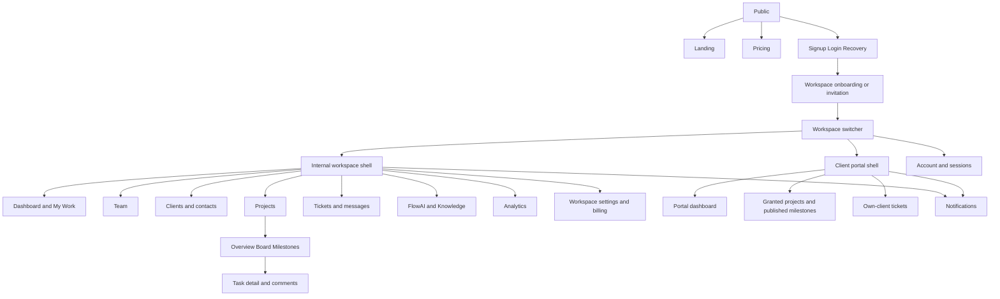
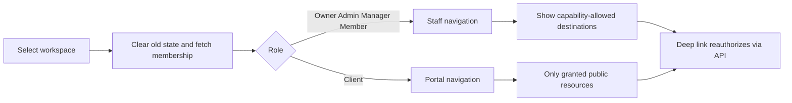

# 07 · Screen specifications

Status: planned screens only. Role and field filtering comes from the API, never frontend hiding alone. All authenticated screens support a 401 re-login path preserving a safe return URL; 403 shows a permission explanation only for visible resources, 404 conceals inaccessible ones. Query keys and navigation are workspace-scoped.

## Sitemap and navigation

Global state rule: show structural skeleton on first load, keep permitted stale data only within the same workspace during background refresh, retain filters/forms on recoverable failure, offer explicit retry, and distinguish first-use empty from zero search matches. Never show another tenant's stale content during switching. Below each screen specifies exceptions and meaningful states.

## 01 · Public landing `/`

- Purpose/roles: explain product to prospective agency buyers, public.
- Layout/sections: public header, product promise, workflow explanation, planned module previews labeled concept, security principles, CTA, footer/legal links once real policies exist. No fabricated customers or testimonials.
- Components/interactions: Button, Badge, Tabs for software/marketing scenarios, accordion-style accessible details; CTA to signup, pricing navigation.
- Data: static reviewed product copy, feature-stage labels; no private API. States: render static content without API; unavailable signup shows honest availability; no invented live activity.
- Mobile: stacked sections, readable headline, drawer menu, reduced animation.

## 02 · Pricing `/pricing`

- Purpose/roles: help public buyers compare validated plans.
- Layout/sections: catalog cards, limits table, billing interval control, FAQ and contact path when configured.
- Components/interactions: Tabs, Table, Button, Tooltip; select plan carries planId into onboarding, never a browser-controlled price.
- Data: GET /plans; prices/currency only from active catalog. States: skeleton cards; catalog-unconfigured explanation instead of fictional prices; retry service errors.
- Mobile: vertical plan cards, scrollable comparison with clear labels; no hidden limit disclosures.

## 03 · Signup `/signup`

- Purpose/roles: create global identity, public.
- Layout: small centered form, name/email/password, policy links after policy approval, login link.
- Components/interactions: Input, Button, inline validation, password reveal, generic verification confirmation; disable duplicate submit.
- Data: CSRF bootstrap, signup response; no auto workspace or subscription purchase. States: per-field errors, 429 cooldown, generic existing-email result to prevent enumeration.
- Mobile: full-width form, proper autocomplete, avoid password blocking/paste restrictions.

## 04 · Login `/login`

- Purpose/roles: authenticate returning users.
- Layout: centered email/password, forgot link and invitation-aware return context.
- Components/interactions: form, spinner button, generic failure alert; after success fetch workspaces and choose onboarding/switcher.
- Data: auth CSRF/login/user; cookies are HttpOnly. States: invalid credentials, unverified account after valid password, disabled account support path, rate-limit timer.
- Mobile: single column, keyboard-safe submit and accessible reveal.

## 05 · Forgot/reset password `/forgot-password`, `/reset-password`

- Purpose/roles: recover identity, public with action token.
- Layout: email request then separate new-password form; token not rendered as text.
- Components/interactions: Input, Alert/Error state, Button; generic email confirmation; successful reset returns to login and states existing sessions were revoked.
- Data: reset token held only long enough to submit; strip URL token from history immediately, no analytics/referrer leakage. States: expired/consumed link requests fresh email, policy failures preserve safe input.
- Mobile: simple vertical flow. Email verification is a related `/verify-email` utility state using the same token-handling rules.

## 06 · Workspace onboarding `/onboarding`

- Purpose/roles: verified new owner creates workspace; invited user accepts existing workspace separately.
- Layout: name/slug, agency context explanation, completion panel; invitation path shows inviter/workspace safe metadata only if accessible.
- Components/interactions: step indicator, Input, Button; creationKey persists across retries, no paid checkout without explicit selection.
- Data: workspace creation and membership, initial trial entitlement. States: slug conflict inline, unverified user action, membership invitation conflict handled without silent role change.
- Mobile: one step per viewport, back preserves entered values.

## 07 · Workspace dashboard `/w/:w/dashboard`

- Purpose/roles: Owner/Admin overview, Manager assigned projects, Member own work.
- Layout: greeting + scope label, overdue/tasks/tickets summary, My Work list, scoped recent activity, quick actions allowed by capability.
- Components/interactions: Cards, Table, Badge, Skeleton, filters; counts link to matching scoped list.
- Data: analytics overview, tasks, activity; derived totals include asOf/methodology. States: first-project prompt only to creators; empty My Work, partial widget failures isolated.
- Mobile: stacked summary, priority list before secondary analytics, no dense charts.

## 08 · Workspace switcher `/workspaces` and topbar dialog

- Purpose/roles: all authenticated identities select active membership.
- Layout: searchable workspace list with role and Client portal marker, create option for verified users.
- Components/interactions: Command, Avatar initials, Dialog; selection aborts old requests, clears prior cache/socket context and navigates to role landing.
- Data: own active memberships only. States: no membership leads to create/invite guidance; removed workspace disappears; failed context fetch does not show old tenant content.
- Mobile: full-height drawer or dedicated page, large row targets.

## 09 · Team and members `/w/:w/team`

- Purpose/roles: Owner/Admin govern membership; staff see assignment-relevant safe summaries rather than full administration.
- Layout: members table, pending invitations, role explanation, invite dialog; role/remove actions only per hierarchy.
- Components/interactions: Table, Select, Dialog, Confirmation; last-owner rejection explained, no self-escalation control.
- Data: members/invitations and capabilities; no global user directory. States: no pending invites, email mismatch, expired invite, concurrent owner change refresh.
- Mobile: cards with role labels, actions in menu, invite full-screen dialog.

## 10 · Clients directory `/w/:w/clients`

- Purpose/roles: Owner/Admin manage customer accounts; Manager/Member see project-linked summaries.
- Layout: search/status controls, client table/cards, create button if allowed.
- Components/interactions: Input, Table, Badge, Pagination, create Dialog; row name links detail.
- Data: scoped clients, no contacts/notes in unauthorized summaries. States: first client prompt for admins, no assigned clients for staff, filtered zero results.
- Mobile: stacked client cards and collapsible filters.

## 11 · Client details `/w/:w/clients/:id`

- Purpose/roles: Owner/Admin manage profile/contacts; project staff see safe linked summary; Client safe own-company view through portal context.
- Layout: name/status header, profile panel, contacts admin-only, permitted projects and tickets, internal notes admin-only.
- Components/interactions: Tabs, form, Table, invite dialog; archive confirmation explains active dependencies.
- Data: client DTO plus separately authorized contacts/projects. States: partial section errors, no contacts/projects, linked identity cannot silently change email.
- Mobile: single-column tabs, action drawer.

## 12 · Projects list `/w/:w/projects`

- Purpose/roles: staff see accessible projects; portal counterpart lists granted published projects.
- Layout: heading/create action, list/grid toggle, status/client filters, project summaries.
- Components/interactions: Table/cards, Badge, Select, Pagination; Manager creation obtains manager grant.
- Data: scoped project pages, safe client name, permitted summary counts. States: no projects, no grants, filtered zero; forbidden create never shown.
- Mobile: cards, concise client/status/date and clear detail link.

## 13 · Project details `/w/:w/projects/:p/overview`

- Purpose/roles: internal project work and client published overview via portal route.
- Layout: breadcrumb/header/status, overview/board/milestones tabs, description, progress summary; staff access-management panel restricted to managers/admins.
- Components/interactions: Tabs, Badge, Avatar group, Dialog, visibility confirmation; publish warns exactly which fields become visible.
- Data: project DTO, grants only if manager, scoped tasks/milestones. States: archived banner read-only as policy allows; denied/removed project 404; no tasks prompt.
- Mobile: tabs scroll within region, header actions in menu, no hidden publication state.

## 14 · Kanban `/w/:w/projects/:p/board`

- Purpose/roles: internal staff coordinate task progress; Client gets public task list rather than internal board in MVP.
- Layout: fixed status columns, paginated cards, filters, add task, list alternative.
- Components/interactions: task cards, Dropdown, status Select, Drawer; drag optional, keyboard menu always available; optimistic move rolls back on failure and 409 prompts refresh.
- Data: per-column tasks, server ranks, versions and valid assignees. States: empty column add action, loading next page, stale ordering message, task disappears on revoked access.
- Mobile: one selected column or list; no mandatory drag or page-wide overflow.

## 15 · Task details `/w/:w/tasks/:t`

- Purpose/roles: parent-authorized staff edit permitted fields; Client views public projection through portal deep link.
- Layout: drawer/full page, title/status, description, assignee/due/milestone, comments, files, activity; separate publicSummary and publish control for managers.
- Components/interactions: form, Select, Tabs, attachment uploader, comment composer; dirty-close confirmation, concurrency conflict preserves local draft for comparison.
- Data: task version, allowed fields, comments/files filtered by visibility. States: deleted/revoked 404, scan pending/quarantine, empty comments, failed save retains content.
- Mobile: full-screen panel with sticky safe actions; comments and properties stacked.

## 16 · Client portal dashboard `/w/:w/portal/dashboard`

- Purpose/roles: Client understands delivery without internal metadata.
- Layout: agency/workspace brand, granted project cards, upcoming published milestones, same-client ticket summary, notifications.
- Components/interactions: Cards, Badge, Button, empty state; view project/create ticket. No staff navigation, AI or billing.
- Data: client-scoped published project/milestone/ticket DTOs only. States: no granted projects is a valid state with agency-contact guidance; stale links conceal removed resources.
- Mobile: simple stacked cards and short navigation drawer.

## 17 · Milestones and deliverables `/w/:w/projects/:p/milestones`

- Purpose/roles: staff track delivery, managers publish, Client reviews published status/files.
- Layout: chronological list with due timestamp/status, linked published tasks and clean authorized attachments.
- Components/interactions: Table/cards, Badge, Dialog; manager add/edit, delivered state; no legal acceptance workflow at launch.
- Data: scoped milestones, permitted related task/files (files attach to tasks, not a new milestone parent type). States: no milestones, overdue textual label, unpublished badge staff-only, download failures.
- Mobile: timeline/list cards, timestamps wrap with timezone.

## 18 · Support inbox `/w/:w/tickets` or `/portal/tickets`

- Purpose/roles: admins/all, managers/project or assigned, members/assigned, clients/same client.
- Layout: search/status/priority filters, ticket list, assignment controls where allowed, new ticket.
- Components/interactions: Table, Select, Pagination, Drawer; filters persisted in URL within allowed scope, no client-select for Client.
- Data: scoped tickets and allowed assignment candidates. States: empty queue versus zero search matches, partial counts unavailable without blocking list, revoked tickets vanish.
- Mobile: list cards with number/status/subject, filters in drawer.

## 19 · Ticket detail `/w/:w/tickets/:id` or portal equivalent

- Purpose/roles: authorized staff/Client hold a support conversation.
- Layout: ticket header/status, chronological thread, public reply/internal note composer staff-only toggle, attachment panel, restricted assignment sidebar.
- Components/interactions: Badge, Textarea/Input, Tabs, upload status; internal composer visually explicit and default for staff must be chosen before typing; Client only public.
- Data: ticket version and filtered messages. States: first-message skeleton, failed send preserves draft and idempotency key, closed banner, scanning attachment state.
- Mobile: full-width conversation, properties collapsible, composer never covers last message.

## 20 · Notification center `/w/:w/notifications`

- Purpose/roles: each active member's own durable inbox.
- Layout: unread/all tabs, grouped safe summaries and timestamps, mark-read actions.
- Components/interactions: Tabs, list, Badge, Pagination; click refetches target, stale inaccessible target yields generic no-longer-available.
- Data: own notifications, cursor reconciliation after socket hints. States: caught-up message, failed mark-read rollback, reconnect refresh indicator.
- Mobile: full page; topbar preview uses bounded list and view-all link.

## 21 · FlowAI `/w/:w/ai`

- Purpose/roles: entitled internal staff ask grounded questions or draft task text.
- Layout: scope/source selector, question composer, session-only conversation, answer with citations and quota summary.
- Components/interactions: Input, Button, source combobox, citation cards; cancel request, retry explicitly, copy draft; no automatic business mutations.
- Data: permitted source metadata, AI endpoint/usage; no durable conversation collection at launch. States: no ready sources, quota exhausted, unsupported evidence refusal, timeout/invalid response with no false answer.
- Mobile: composer below bounded response flow, sources in drawer; keyboard and live region do not announce whole answer repeatedly.

## 22 · Knowledge base `/w/:w/knowledge`

- Purpose/roles: staff browse allowed sources; Owner/Admin/project Managers ingest within scope.
- Layout: source list, scope/status filters, add document dialog, document status/details panel.
- Components/interactions: Table, Badge, uploader, job progress, revoke confirmation; text creates directly; file source reserves a document, uploads to it, waits for clean scan, then ingests; retry failed ingestion with new generation.
- Data: documents, authorized attachment metadata, jobs; never expose vectors/provider secrets. States: no sources, processing/index lag, sanitized parsing failure, revoked sources disappear immediately.
- Mobile: source cards and full-screen ingestion form.

## 23 · Analytics `/w/:w/analytics`

- Purpose/roles: Owner/Admin workspace, Manager assigned projects, Member own counts; Client summary stays in portal dashboard.
- Layout: date/scope controls, metric cards, task status distribution, ticket aging table, AI totals if allowed, definitions/asOf.
- Components/interactions: Select, Table, accessible charts with text table alternatives; no predictive “AI insights” at launch.
- Data: scoped aggregate endpoint, no invented historical series; distinguish zero from unavailable data. States: range validation, insufficient history, partial service failure.
- Mobile: cards and tables before charts; labels readable without hover.

## 24 · Workspace settings `/w/:w/settings`

- Purpose/roles: Owner/Admin configure allowed settings; Owner governs ownership/export/deletion.
- Layout: general name/timezone/locale, governance, restricted danger zone, audit-log view for Owner/Admin.
- Components/interactions: form, Tabs, Confirmation, recent reauth Dialog; destructive request shows recovery window and exact workspace slug.
- Data: workspace version/capabilities, ownership guard, job states, audit logs. States: stale settings conflict, retention hold, export queued, deletion pending read-only banner.
- Mobile: stacked form, dangerous actions separated with plain impact text.

## 25 · Account settings `/account`

- Purpose/roles: all authenticated users manage own identity/theme and sessions.
- Layout: display name, email read-only at launch, theme preference, active session list, logout/revoke controls; password recovery link.
- Components/interactions: form, Select, Table/cards, Confirmation for other-session revoke.
- Data: /users/me and own sessions; theme initially browser preference until account preference field is added explicitly in Phase 2/4. States: no other sessions, revoking current session redirects to login, failed save retains fields.
- Mobile: vertically stacked devices and touch-friendly revoke actions.

## 26 · Billing and plans `/w/:w/billing`

- Purpose/roles: Owner only inspects entitlements and uses hosted payment flows.
- Layout: active plan/status/period, seats/storage/AI usage, valid catalog comparison, checkout/manage button, sanitized billing event history when available.
- Components/interactions: Cards, Table, Badge, Confirmation, Button; recent reauth before hosted session creation; return from provider shows pending reconciliation until verified.
- Data: subscription, plans, permitted usage; no card details, fake invoices or fabricated prices. States: provider/catalog unconfigured, payment pending/past-due, checkout retry with same key, canceled-but-paid-through explanation.
- Mobile: stacked limit summaries; external navigation warns naturally via button label, no inaccessible embedded payment UI.

Billing history uses the Owner-only subscription events endpoint in document 05; it never exposes unmapped global webhook intake records.
