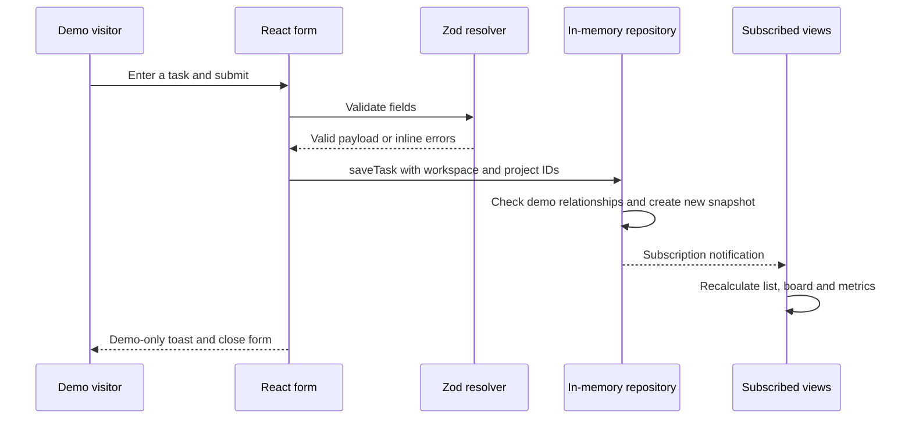

# Phase 2 · Frontend architecture and learning guide

Scope: a real, executable React frontend demo inside root-level `frontend/`. No Express application, MongoDB connection, authentication service, payment integration, AI provider, upload service or Socket.IO server was created. `backend/` is reserved for Phase 3 and remains absent. Phase 1 documents retain their original design scope; only affected frontend/backend path conventions were updated.

## Setup and commands

Use Node 24 LTS, or a compatible Node 22 release from 22.13.0. The verified environment uses Windows, Node 24.15.0 and npm 11.12.1. ESLint 10 and Vite have overlapping but different runtime requirements; the package engine range reflects both. Do not install dependencies at the repository root.

```powershell
Set-Location C:\FLOWWORKAI\frontend
npm.cmd install
npm.cmd run dev
```

Vite prints a local URL, normally `http://127.0.0.1:5173`. The public landing page is `/`; the main demo is `/w/studio/dashboard`, the second fictional workspace is `/w/lab/dashboard`, and the client preview is `/w/studio/portal/dashboard`. The lab workspace intentionally starts empty to exercise empty states and workspace switching.

`npm.cmd` avoids the PowerShell script execution restriction on `npm.ps1`. In an unrestricted shell, the requested `npm install` and `npm run dev` commands are equivalent. For deterministic reinstallations use `npm.cmd ci` with the committed lockfile. Do not run an independent installation while another installer is active.

```powershell
npm.cmd run typecheck
npm.cmd run lint
npm.cmd run test
npm.cmd run build
npm.cmd run preview
```

`build` checks TypeScript before emitting `frontend/dist/`; `preview` serves that production build locally, normally on port 4173. A static host will need SPA navigation fallback to index.html for deep links. No deployment was requested or performed.

## Folder structure

```text
FLOWWORKAI/
  frontend/
    public/                    original favicon
    src/
      app/                     providers and demo repository context
      assets/                  original FlowWork mark
      components/
        ui/                    shared primitives, including shadcn separator
        layout/                public and application shells
        shared/                headers, states, user picker, error boundary
        charts/                Recharts views and accessible data summaries
      features/
        auth/                  account forms, verification and onboarding UI
        dashboard/             dashboard, marketing, notification center
        workspaces/            workspace picker
        projects/              project forms, list, details and milestones
        tasks/                 task form/drawer/list and Kanban
        clients/               directory/details/forms and client portal
        team/                  member directory/profiles/invitation drafts
        tickets/               inbox, ticket form, messages and properties
        ai/                    scripted assistant preview
        knowledge-base/        sample sources, categories and file metadata UI
        analytics/             scoped demo calculations, charts, CSV export
        billing/               illustrative plan definitions and views
        settings/              profile/workspace/appearance/preference UI
      hooks/                   useDemo subscription and workspace selection
      lib/                     class merge, dates, progress and overdue helpers
      mocks/                   centralized deterministic fixtures and clock
      routes/                  centralized nested routes, paths and fallbacks
      services/                typed in-memory repository and invariant tests
      stores/                  Zustand UI preferences
      styles/                  Tailwind entry and semantic design tokens
      types/                   domain interfaces and status labels
      test/                    DOM setup and interaction tests
      App.tsx                  providers and router composition
      main.tsx                 React root, local font and stylesheet
    e2e/                       browser smoke, workflow and accessibility tests
    package.json               frontend dependencies and commands
    package-lock.json          resolved dependency graph
    tsconfig.json              strict TypeScript configuration
    vite.config.ts             React/Tailwind plugins, aliases, test and chunks
    playwright.config.ts       browser projects and local server lifecycle
  backend/                     RESERVED; absent until Phase 3
  docs/                        preserved planning and Phase 2 guides
  AGENTS.md
  .gitignore
  README.md
```

There is no nested `frontend/frontend`, `backend/backend`, `apps/web` or `apps/api` directory. Backend dependencies and secrets must remain separate in future phases. A proposed shared contracts package in Phase 1 is still a future packaging choice, not an installed root workspace.

## React components, props, state and hooks

A component is a function that turns props and current state into UI. Props are inputs supplied by a parent: `ProjectForm` receives an optional existing project and an `onClose` callback. The same form supports creation and editing without duplicating validation. Shared `Button`, `Field`, `Modal`, `Table` and badge components keep behavior and styling consistent across features.

Component state belongs near the interaction: searches, filters, view toggles, file metadata previews and conversation selection use React state. React Hook Form manages form fields and validation state; Zod describes their accepted shape. The resolver connects the schema to inline errors. A valid authentication form only shows an integration-unavailable message and clears password fields; it does not create a token, account or session.

Hooks connect reusable behavior to React. `useDemo` reads the repository context, subscribes with `useSyncExternalStore`, resolves the workspace from the route and returns scoped lists. Forms use `useWatch` to recalculate eligible assignees/projects when a related field changes. `Providers` follows the OS color scheme when theme is `system` and cleans up its media-query listener. Resource cleanup revokes local logo blob URLs. Heavy chart and feature modules load through route-level lazy imports.

The shared error boundary catches rendering failures and offers an explicit reload that restores fixture state. Router-level errors have their own fallback. These controls do not pretend to recover a failed remote mutation, because no remote service exists yet.

## State ownership

| Kind of state | Owner | Lifetime |
|---|---|---|
| Projects/tasks/clients/tickets/comments/notifications | Typed demo repository with immutable snapshots | Browser app instance; refresh resets |
| Current workspace, resource and project section | React Router URL | Navigable and deep-linkable |
| Filter text, list/board choice, local source selection | Closest feature component | Component lifetime |
| Form input and field errors | React Hook Form + Zod | Form lifetime |
| Theme and collapsed sidebar | Zustand persist | Non-sensitive localStorage preferences |
| Command dialog and quick-create state | Zustand UI store | App instance; not persisted |
| Future remote data | TanStack Query provider prepared | Not currently used to disguise local arrays as server queries |
| Profile/notification preference preview | Settings page state | Page lifetime, explicitly labeled |
| Scripted assistant messages | Assistant page state | Page lifetime; no history database |

Zustand is not a second database. TanStack Query is configured now for backend integration but is deliberately not used to fetch local fixture arrays. When a REST adapter exists, queries/mutations should become the owner of remote entities; avoid keeping both an independent repository snapshot and a query cache as competing sources of truth.

## Mock data and repository

`createFixtures()` returns a fresh deep clone with stable IDs and coherent relationships. Two workspaces exist, with fictional Northstar staff and four fictional clients. Projects refer to client IDs, tasks refer to project/member IDs, and ticket messages refer to their ticket. `DEMO_NOW` is 6 November 2026 at 10:00 UTC; overdue counts do not change based on a viewer's actual clock.

The initial Northstar dataset contains four projects, 14 tasks and five support tickets. Counts on dashboard/analytics derive from those same arrays. Completing a task updates completion percentages everywhere in the mounted app. Resolution metrics use actual fixture created/resolved timestamps. Charts describe current task status grouped by due date, rather than pretending to contain historical velocity events. Date-range controls filter tasks by due date and tickets by opened date. A local CSV export contains only those demo summaries.

`DemoRepository` is the adapter contract. Methods return created records and emit new immutable snapshots. Integrity checks reject unknown workspaces, foreign project/client references, invalid assignees, conflicting client/project relationships and duplicate invitation drafts. Published project client association and task assignment relationships are kept stable during editing. These browser checks improve demo consistency; anyone can inspect or alter browser code, so **they are not authorization controls**.

Sequence numbers create stable IDs during one session, without random fixture counts. `reset()` restores the original dataset. Domain changes are not serialized to localStorage. File preview does not save binary content or simulate completed scanning/indexing. Pending/ready/failed knowledge states are explicitly labeled fixture states.

## Request and interaction flow



No HTTP request, database write, authorization decision or AI call appears in this implemented flow. That separation makes the demo honest and keeps later backend integration reviewable.

## Routing and navigation

`routes/router.tsx` defines public layout routes, auth/onboarding pages, workspace layout children, a separate client portal layout, redirects and 404 handling. `routes/paths.ts` centralizes top-level patterns. Resource links derive from the current workspace base, so switching to Atelier Lab does not retain the Northstar route context.

Public: `/`, `/features`, `/pricing`. Account UI: `/login`, `/signup`, `/forgot-password`, `/reset-password`, `/verify-email`, `/onboarding`, `/workspaces`. Workspace: `/w/:workspaceId/dashboard`, `projects`, `projects/:projectId/:section`, `tasks`, `tasks/:taskId`, `clients`, `team`, `tickets`, `ai`, `knowledge`, `analytics`, `notifications`, `settings/:section`, `billing`. Details routes exist for clients, members, tickets and knowledge documents.

Portal: `/w/:workspaceId/portal/{dashboard,projects,tickets,notifications}`, with project/ticket detail routes. This presentation is fixed to the fictional Orbit client. It omits internal descriptions, notes and staff assignment controls. It is not an authenticated Client role or production tenant boundary; all fixture data is bundled in the browser.

Direct task links open a named drawer with their own close/navigation fallback. Drawers and dialogs use Radix focus management, Escape support, labeled titles/descriptions and explicit focus restoration. The command dialog opens from the topbar or Ctrl/Cmd+K and provides tab-accessible results. Desktop navigation collapses, tablet uses an icon rail, and mobile navigation uses a drawer. Workspace switching closes old transient creation/search state and remounts workspace content.

## Design system and accessibility

The supplied brand remains the foundation: #0B1020 canvas, #151D30 surfaces, #6366F1 primary, #22D3EE accent and #F8FAFC light text. CSS variables define light/dark semantic text, surface, border, focus, status and action colors. Inter is self-hosted through Fontsource under OFL-1.1; no third-party font request is needed. Illustrations are original HTML/CSS product previews and original SVG marks, with no copied brand assets or fabricated customer proof.

Tailwind 4 uses `@tailwindcss/vite` and `@import "tailwindcss"`, with no outdated generated Tailwind 3 configuration. Shared primitives follow shadcn/Radix composition conventions. The separator was installed from the official shadcn registry and adjusted to the existing `@/lib/utils` helper; duplicate helper dependencies were removed. `components.json` records the component aliases for future registry additions. Button variants use class-variance-authority and class merging; complex overlays, tabs, avatars, checkbox/switch/radio behavior use Radix. Native labeled selects/date controls are intentional for mobile and keyboard usability.

Reusable elements cover buttons, inputs/textarea/select/date, checkbox/radio/switch, avatar/badge/card, modal/confirmation/sheet, dropdown/tooltip/popover, tabs/breadcrumb/table/pagination, skeleton/loading/error/empty states, search/status/priority/user selection, headers/fields and Sonner toasts. Components expose meaningful states and controls; unavailable integrations explain their boundary rather than showing fake success.

Responsive layouts stack cards, contain table overflow within named scroll regions, and allow horizontal board scrolling without widening the page. Every card has a status select as an alternative to dragging. Dnd-kit also supplies pointer/keyboard sensors and drag instructions. Charts have textual data summaries. Focus indicators, skip links, live status messages, contrast tokens and reduced-motion rules support accessible use.

Automated accessibility checks cover selected routes in both themes and browser viewport profiles; this is not WCAG certification or a substitute for manual screen-reader/zoom testing. See the final report for actual executed results and limits.

## Future backend integration

1. Start only after Phase 3 is explicitly authorized. Create the Express foundation in `backend/`, with its own package, TypeScript config and environment schema.
2. Implement the documented API envelopes/validation and current membership/resource checks. Client-only filtering cannot enforce tenancy.
3. Define an asynchronous REST repository/service boundary and transport DTO mapping. Do not expose Mongoose documents or backend imports in the frontend.
4. Replace fixture reads with workspace/principal-scoped TanStack Query keys and mutations. Invalidate relevant project/task/analytics lists on success; handle 401/403/404/409/422 distinctly and preserve drafts on failures.
5. Replace demo IDs and date-only fixture fields with validated API identifiers/timestamps. The current demo labels date inputs as UTC; decide exact deadline timestamp/timezone conversion from the Phase 1 contract before enabling real writes.
6. Map UI labels to domain values: task `review` displays “In Review”; ticket `waiting_client` displays “Pending”. Preserve the Phase 1 backlog state in list/form models; the board has the four requested primary columns and adds Backlog only if a demo task actually uses it.
7. Connect cookie-based auth/CSRF only when backend sessions exist. Never put tokens in localStorage or turn the demo entry button into a pretend login.
8. Integrate verified private uploads/scanning, notification delivery, provider billing and read-only AI behind explicit future phase gates. Require backend authorization and human approval for sensitive future actions.

No Vite environment variables are required today. Future `VITE_*` variables are public build-time configuration (for example an API base URL), never database credentials, signing secrets, payment keys or LLM keys. Keep backend `.env` files outside `frontend/`; `.gitignore` excludes secrets, dependencies, build output and test artifacts while allowing non-secret `.env.example` templates.

## Test workflow

Vitest/React Testing Library cover repository invariants, landing/shell rendering, validation, project creation/filtering, task creation, board status controls, themes, command/dialog behavior, notification read state and Client presentation filtering. Browser tests cover routes, interactions, pointer dragging, workspace changes, viewport overflow and selected accessibility checks.

```powershell
Set-Location C:\FLOWWORKAI\frontend
npm.cmd run test
npm.cmd run test:e2e
npm.cmd run format:check
```

Default Playwright projects use installed Chrome for desktop and Pixel 7 emulation. If Chrome is unavailable, use bundled Chromium:

```powershell
npx.cmd playwright install chromium
$env:PLAYWRIGHT_CHANNEL = 'chromium'
npm.cmd run test:e2e
Remove-Item Env:\PLAYWRIGHT_CHANNEL
```

Playwright starts Vite at 127.0.0.1:4173 or reuses an existing compatible server. Run one Playwright invocation at a time because reports/artifacts share output directories. Tests run in isolated contexts with independent demo state. `frontend/playwright-report/`, `test-results/`, `dist/` and `node_modules/` are ignored, not committed. Review traces/screenshots for failures; do not raise timeouts or suppress checks to hide regressions.

## Known limitations and boundaries

- No backend, persistent domain data, secure login, role enforcement, email delivery, private uploads, malware scanner, RAG, live LLM, actual payment/subscription, real-time delivery or legal/compliance claim.
- Owner is a demonstration persona; role badges are data and presentation, not an authorization system. Platform administrative access is not implemented.
- Client presentation is limited to Orbit. Publication/grants, milestone editing, true deliverable downloads, audit/export/deletion/security operations require their documented backend phases.
- Profile and delivery preference forms are explicitly page-local previews; only workspace name/description update the shared in-memory fixture repository. Logo images are local blob previews and are never uploaded.
- Assistant history is page-local. A scripted response may be incomplete; arbitrary custom prompts receive an unavailable-integration explanation.
- Analytics uses a fixed snapshot and derived demo counts. It is not verified business performance, historical production telemetry or a capacity benchmark.
- Browser automated checks do not cover every device/browser/screen reader. No production security, load, restore or contractual availability tests have been run.
- The lockfile includes a patched minimatch override to resolve the lint toolchain advisory. Recheck compatibility/audit on dependency upgrades. Vite may emit third-party Zod annotation warnings; they are not application errors and are recorded with the actual build results.

Phase 2 ends with this frontend and its verification/documentation. Phase 3 prerequisites are backend structure/configuration, API contract review, structured logging/errors, transport validation, CORS/CSRF design and a test harness. No Phase 3 code is included.
