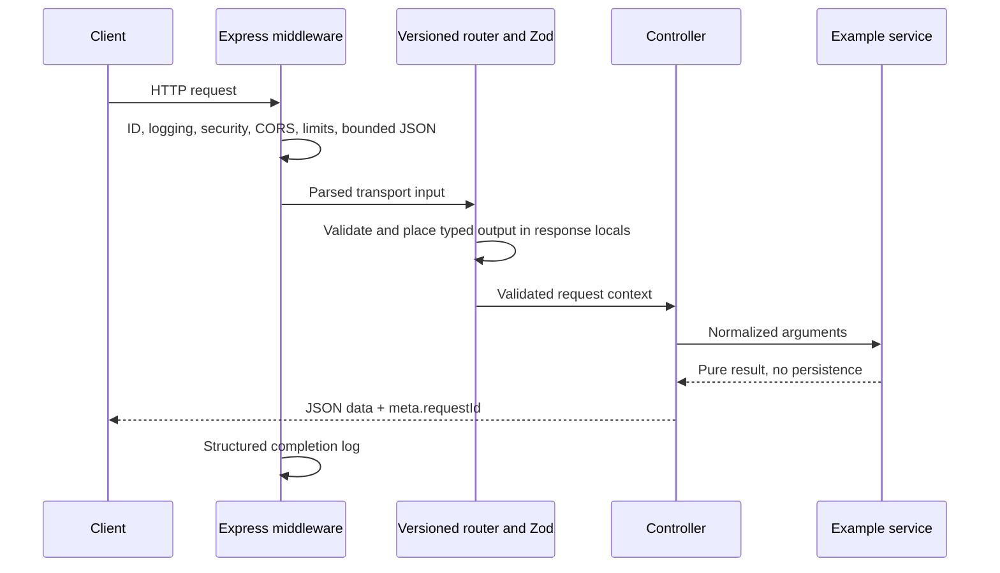

# Phase 3 · Backend foundation architecture

The executable foundation lives in root-level `backend/`, independently of `frontend/`. It implements HTTP infrastructure and teaching examples, with no database, authentication, sessions, business CRUD, Socket.IO, AI, queue or payment integration. Phase 1 and Phase 2 guides remain historical designs/reports; this document describes the Phase 3 implementation.

## Decisions and scope reconciliation

1. Use Express 5 with strict TypeScript, Node ESM, Zod, Helmet, CORS, Pino/pino-http and express-rate-limit. Dependencies and a lockfile live only in backend. Node 24/26 supported LTS majors are the engine range; use a current patched release. The actual execution host uses Node 24.15.0; it was not upgraded by this task.
2. Use the newest TypeScript 6.0 release compatible with the installed typescript-eslint peer range. Installing TypeScript latest initially selected 7.x and produced a peer conflict; no force/legacy-peer-deps bypass was used. Frontend compiler/dependencies remain independent and unchanged.
3. Preserve the canonical Phase 1 envelopes: `{data, meta:{requestId}}` and `{error:{code,message,details}, meta:{requestId}}`. The Phase 3 brief's success-boolean/top-level-ID samples are illustrative, not a required incompatible contract change. Schema/relationship validation returns 422; malformed transport returns 400. All error responses include a details array, even when empty.
4. Export an application factory from app.ts rather than a global preconfigured app. Each call returns a real isolated Express application, allowing Supertest injection without startup, global limits or environment-reading side effects.
5. Disable the example router in production. `npm start` forces production configuration even if a copied local .env says development. `npm run dev` honors NODE_ENV/default development.
6. Defer Redis, job-library/adapter selection and worker infrastructure mentioned in the original Phase 1 Phase 3 schedule: the latest approved brief explicitly limits this phase to HTTP foundation. No original planning document was rewritten to pretend those integrations exist.
7. Do not modify or connect the frontend mock repository. A health fetch recipe below is sufficient preparation. CORS credentials remain disabled until the future cookie/session/CSRF design is implemented and tested.

## Folder structure

```text
backend/
  src/
    config/                 pure validated env parser and exact CORS allowlist
    middleware/             request ID, route labels, validation, rate limits,
                            not-found and central errors
    modules/
      health/               routes → controller → HTTP lifecycle service
      example/              routes → schemas → controller → pure demo service
    routes/index.ts         /api/v1 registry and production example exclusion
    lib/                    API errors, safe logger, async adapter, HTTP lifecycle
    utils/response.ts       success envelope helper
    types/http.ts           DTO and validated-controller/locals types
    app.ts                  application factory, no listen call
    server.ts               configuration, actual listener, process lifecycle
  tests/
    helpers.ts              isolated configuration and captured JSON logging
    integration/            routes/security/logging and ephemeral-port lifecycle
    unit/                   env, process/error utilities and OpenAPI contract
  openapi.json              validated OpenAPI 3.0.3; six implemented operations
  .env.example              non-secret local settings
  .gitignore                secrets, dependencies, build and test artifacts
  package.json
  package-lock.json
  tsconfig.json             strict typechecking for source and tests
  tsconfig.build.json       source-only ESM build → dist/
  vitest.config.ts
  eslint.config.js
  .prettierrc.json
```

No `apps/api`, `apps/web`, nested backend directory, root dependency package, database model or frontend source change is needed.

## Local execution on Windows

```powershell
Set-Location C:\FLOWWORKAI\backend
npm.cmd install
# Optional; local defaults also work without a file. Do not overwrite an existing .env.
if (-not (Test-Path .env)) { Copy-Item .env.example .env }
npm.cmd run dev
```

Default HTTP listener: `http://127.0.0.1:5000` (also reachable through localhost on a normal IPv4 loopback setup). Default Vite origins: `http://localhost:5173` and `http://127.0.0.1:5173`. Configure PORT/HOST/FRONTEND_ORIGIN separately from frontend configuration. Never place backend secrets in Vite variables. No real .env is committed or required for the default development example.

Node loads an optional local `.env` with its native `--env-file-if-exists` flag before the entrypoint. Existing process environment values take precedence over file values. There is no dotenv dependency, global TypeScript requirement or CommonJS/ESM mixture. TypeScript source imports use `.js` specifiers, which resolve correctly under NodeNext and in compiled output.

```powershell
npm.cmd run typecheck
npm.cmd run lint
npm.cmd run test
npm.cmd run build
npm.cmd run format:check
```

Production-mode compiled startup requires an explicit HTTPS frontend origin. Example below is a local smoke-test configuration, not a deployed domain or TLS implementation:

```powershell
$env:FRONTEND_ORIGIN = 'https://console.example.com'
$env:HOST = '127.0.0.1'
$env:PORT = '5000'
npm.cmd start
```

`start` executes `node --env-file-if-exists=.env dist/server.js --production`. The flag overrides a local development NODE_ENV, preventing accidental production demo exposure. Production HTTPS is terminated by future hosting infrastructure; Helmet headers do not create TLS. Set actual deployment origins/host/port in the deployment environment, not source code. No deployment configuration was changed in this phase. Remove temporary shell variables after a smoke run if they should not affect subsequent development.

## Environment contract

| Variable | Development/test default | Validation and production behavior |
|---|---|---|
| NODE_ENV | development | development, test or production only; start forces production |
| PORT | 5000 | Integer text 1–65535; zero is rejected in environment configuration |
| HOST | 127.0.0.1 | Explicit IPv4, unbracketed IPv6, or localhost; wildcard hostnames/URLs rejected |
| FRONTEND_ORIGIN | Both local Vite origins | 1–10 comma-separated exact HTTP(S) origins, trimmed/deduplicated; no wildcard, credentials, path, query, fragment or trailing slash; explicit HTTPS required in production |
| LOG_LEVEL | debug locally, silent in test, info in production | fatal/error/warn/info/debug/trace/silent only |

Configuration is parsed once at startup; invalid fields produce a nonzero exit and a clear field-name-only error. Rejected values are not logged. Unknown OS environment variables are ignored rather than copied into application configuration. No database URL, JWT secret, session key, LLM key or billing key is introduced.

## Implemented API and envelopes

| Method / path | Available environments | Behavior |
|---|---|---|
| GET /api/v1/health | All | HTTP readiness summary; status ok, safe service/version/phase and UTC timestamp |
| GET /api/v1/health/live | All | Process liveness; remains alive while draining, until listener closes |
| GET /api/v1/health/ready | All | HTTP lifecycle readiness; 503 while unready/draining |
| GET /api/v1/example?limit=2 | Development/test | Deterministic catalog, limit 1–3 (default 3), persisted=false |
| GET /api/v1/example/:code | Development/test | Enum parameter validation: validation, errors or observability |
| POST /api/v1/example/validate | Development/test | Validate/normalize label/count/category; compute label length; persist nothing |

Health checks do not connect to MongoDB or verify queue/storage/provider readiness. They deliberately contain no hostname, PID, memory snapshot, package/runtime versions, credentials or connection metadata. A dependency registry/readiness check must be designed when actual dependencies are introduced.

Development request:

```powershell
Invoke-RestMethod http://localhost:5000/api/v1/health
$body = @{ label = 'Useful example'; count = 2; category = 'general' } | ConvertTo-Json
Invoke-RestMethod -Method Post -Uri http://localhost:5000/api/v1/example/validate `
  -ContentType 'application/json' -Body $body
```

```json
{
  "data": {
    "mode": "development-only",
    "validated": { "label": "Useful example", "count": 2, "category": "general" },
    "characterCount": 14,
    "persisted": false
  },
  "meta": { "requestId": "123e4567-e89b-42d3-a456-426614174000" }
}
```

```json
{
  "error": {
    "code": "VALIDATION_FAILED",
    "message": "Check the highlighted fields.",
    "details": [{ "path": "body.count", "message": "Count must be at least 1." }]
  },
  "meta": { "requestId": "123e4567-e89b-42d3-a456-426614174000" }
}
```

All endpoints are public infrastructure/examples; there are no authentication/authorization guarantees. Unknown routes (including future auth/project/task paths) return a safe 404. Wrong versions do not redirect into v1. HEAD behavior is provided by Express for GET routes. CORS preflight can return 204 with headers and no envelope/body.

## Middleware execution order and request flow

1. Disable Express identification/ETags, select environment, simple query parsing, case-sensitive/strict routing and `trust proxy=false`.
2. Validate/generate request ID and expose X-Request-ID before error-prone parsing.
3. Attach pino-http request logger with safe serializers and correlation.
4. Apply Helmet and no-store/Vary headers.
5. Check exact CORS origin policy and handle allowed preflight.
6. Apply per-app /api/v1 IP rate limiting; exact documented health probes are exempt.
7. Reject new work while draining; liveness remains available.
8. Parse uncompressed JSON under the 16 KiB body cap.
9. Dispatch through the v1 registry, set a safe route template, validate body/query/params, invoke controller and service, return the canonical envelope.
10. Handle unmatched routes, then normalize errors in the final four-argument handler.
11. On response completion, log method/template/status/duration/requestId and error code where applicable.



Controller responsibilities: transport/status/envelope mapping and invocation of a typed service. Service responsibilities: HTTP-independent computation/domain decisions, with no req/res import. Routes assemble policy/schema/controller wiring. Services, clock, logger, configuration and lifecycle state are injected, enabling real fault-path tests without adding publicly callable error endpoints.

Express 5 exposes req.query as a getter. The reusable validator parses `{body,params,query}` into `res.locals.validated`; it does not overwrite raw request properties. Strict schemas reject unknown keys, invalid enum choices, duplicate/non-numeric limits, incorrect body types and out-of-range counts. Labels are trimmed, then checked for 2–80 UTF-16 code units; category defaults to general. Client-side Zod cannot replace this backend boundary.

Express 5 automatically forwards rejected async controller promises. The explicit async-handler utility is provided/tested for adapters that need it but is not redundantly wrapped around native v5 controllers.

## Error behavior

| Status | Codes / reason |
|---|---|
| 400 | MALFORMED_JSON, MALFORMED_URL, INVALID_REQUEST |
| 403 | CORS_ORIGIN_DENIED |
| 404 | NOT_FOUND, including production-disabled examples |
| 413 | BODY_TOO_LARGE |
| 415 | UNSUPPORTED_MEDIA_TYPE for wrong demo content type, encoding or charset |
| 422 | VALIDATION_FAILED with at most 20 safe field details |
| 429 | RATE_LIMITED with Retry-After and standard limit headers |
| 500 | INTERNAL_ERROR, generic public message |
| 503 | SERVICE_UNAVAILABLE for lifecycle readiness/draining or authored operational failure |

Operational ApiError messages are authored public guidance; never wrap an upstream exception message as public text. Parser errors are recognized by type without echoing parser body fragments. Unknown values/errors become generic 500. Stack traces and raw upstream exception messages are never returned to clients, including development. If headers are already sent, the normalized error is delegated for Express connection handling instead of attempting a second JSON response.

## Logging and request IDs

An incoming X-Request-ID is reused only if exactly 36 characters and UUID-shaped (accepted versions 1–8); it is lowercased. Otherwise crypto.randomUUID generates a fresh ID. Duplicated/invalid/oversized values are not echoed. Header, response meta, request context and completion logs use the same value. It is a correlation hint, not a trusted identity, permission or global uniqueness guarantee for caller-supplied values.

Pino logs JSON in every environment. pino-http serializes only the method/status and safe correlation/completion fields; route context logs a template such as `/api/v1/example/:code`, never arbitrary URLs, resource IDs or query strings. Early parser errors/unmatched requests use `[unmatched]`; throttled requests use a fixed rate-limited label. Body/header serialization is excluded, with defensive redaction paths. Diagnostic logs retain error type and at most eight stack frames, excluding the raw exception message and causes. No cookie, Authorization header, body, password, API key, prompt or reset token is intentionally recorded.

Default log levels differ by environment. Health operational metadata is minimal. Operators must still configure log retention/access and avoid adding arbitrary objects/err.message logging in future services.

## Security controls and limits

- Helmet sets CSP, nosniff, frame/referrer and other default headers. HSTS is enabled only in production; no preload or deployment claim is made.
- CORS permits only exact configured origins. Bad origins receive an authored 403; no-Origin operational clients are allowed. Credentialed CORS is off. Non-browser clients can omit/spoof Origin, so this is not authentication or authorization.
- JSON is capped at 16 KiB and decompression disabled. Unsupported media/charset/encoding fails safely. No form, file or cookie parser is added speculatively.
- Default API limit is 120 requests/minute/IP, using express-rate-limit's IPv6 subnet handling and a new process-local store per app. Health probes and allowed preflight are excluded. 429 responses preserve the canonical error envelope and standard headers.
- Trust proxy is false. Spoofed forwarded headers do not change the effective client address or evade limits. Real reverse-proxy topology must be reviewed before configuring explicit trusted hops/subnets; behind a proxy today clients may share a limit.
- Memory limits reset on process restart and are not distributed. An edge/shared limiter is required before scaling replicas or exposing sensitive auth/AI endpoints; no Redis integration is claimed.
- These public infrastructure controls are not tenant isolation, sessions, password security, CSRF protection or resource authorization. Future cookie-bearing unsafe endpoints must implement the Phase 1 session/CSRF policy before accepting real business data.

## Lifecycle and shutdown

`server.ts` validates config, creates the app/state/logger, then opens an actual HTTP listener. Ready is false before listen and true after success. Startup errors produce safe diagnostics and nonzero exit; a busy port is not silently replaced by another port. In tests only, transport fixtures use ephemeral port 0 by constructing an injected config; environment PORT=0 stays invalid.

The listener has a 15-second request-receipt timeout, 10-second header timeout, 5-second keep-alive timeout and bounded header count. These are not a general service execution timeout; future network integrations need their own deadlines.

SIGINT/SIGTERM enter one shared shutdown promise, mark the process unready/draining, stop accepting connections, close idle keep-alive connections and allow active requests to finish. A 10-second deadline bounds server closure plus cleanup hooks. At deadline remaining connections are destroyed and the process exits nonzero; hook failures are surfaced. Unhandled rejection/uncaught exception initiates the same nonzero bounded shutdown rather than continuing in an uncertain state. Signal registration is idempotent per process and disposable for tests/development.

Cleanup hooks are an extension point only. No database/queue connection exists or is “closed” in this phase. Current tests verify successful draining, duplicate shutdown calls, address conflicts, stuck requests, cleanup failures and listener cleanup using real ephemeral listeners or isolated process emitters.

## OpenAPI and tests

`backend/openapi.json` is an OpenAPI 3.0.3 document for exactly six implemented operations, including development-only visibility, headers, error/success envelopes and request schemas. No future auth/business routes are advertised. Swagger UI is not installed or served; the static spec and development-only parser validation add no public UI attack surface. The raw label trimming constraint is described explicitly because JSON Schema length alone cannot describe the preprocessing step.

Vitest/Supertest use a fresh factory/config/limiter; requests bind only temporary Supertest/ephemeral listeners, never the configured 5000 production port. Tests cover config, health/readiness, routing, all validation dimensions, malformed input, CORS, limits/proxy spoofing, IDs, JSON logs/privacy, asynchronous errors, production sanitization and lifecycle. OpenAPI tests validate its structure/references and the implemented response envelope. See the final report for actual counts/commands.

## Frontend connection readiness

Run the unchanged frontend in a second PowerShell terminal:

```powershell
Set-Location C:\FLOWWORKAI\frontend
npm.cmd run dev
```

From that local page's browser console, this diagnostic fetch tests only connectivity:

```js
const response = await fetch('http://localhost:5000/api/v1/health')
const payload = await response.json()
console.log(response.status, payload.data.status, response.headers.get('X-Request-ID'))
```

Do not supply credentials or call login/signup; those routes do not exist. If Vite chooses a different origin/port, explicitly add that exact origin to backend FRONTEND_ORIGIN and restart. PowerShell can inspect headers with `Invoke-WebRequest -Uri http://localhost:5000/api/v1/health -Headers @{ Origin = 'http://localhost:5173' }`. Older Windows PowerShell may need `-UseBasicParsing`.

No frontend API code, environment file, mock repository, route or feature was changed. Future integration will use typed DTOs and workspace/principal-scoped TanStack Query, with real session/CSRF/resource policy first.

## Phase 4 extension points and known gaps

Phase 4 needs explicit authorization, an isolated transactional MongoDB environment, schema/index strategy, secure email delivery and the documented opaque session/password/CSRF lifecycle. Add connection readiness and cleanup hooks only when actual clients exist. Services/repositories must require tenant context before business modules are added. Revisit cookie/CORS/proxy/rate policies with evidence and tests; do not simply enable credentials or trust all proxies.

No persistent state, auth, tenant enforcement, business CRUD, AI/RAG, queue, files, payments or real-time integration is implemented. No production deployment, load/security certification or backup claim is made. The dev toolchain uses a patched minimatch override; maintainers must rerun audit/lint/tests on updates. The frontend and all Phase 1/2 documents are preserved apart from the explicitly requested root README/AGENTS status updates.

Primary references: [Express 5 migration and read-only query behavior](https://expressjs.com/en/guide/migrating-5/), [CORS middleware semantics](https://expressjs.com/en/resources/middleware/cors/), [Pino HTTP configuration](https://github.com/pinojs/pino-http), [rate-limit proxy considerations](https://express-rate-limit.github.io/ERR_ERL_UNEXPECTED_X_FORWARDED_FOR/), [Node environment file flags](https://nodejs.org/api/cli.html#--env-file-if-existsfile) and [Node release policy](https://github.com/nodejs/Release).
