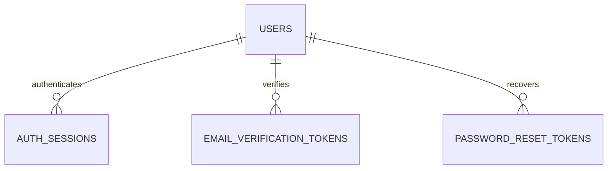
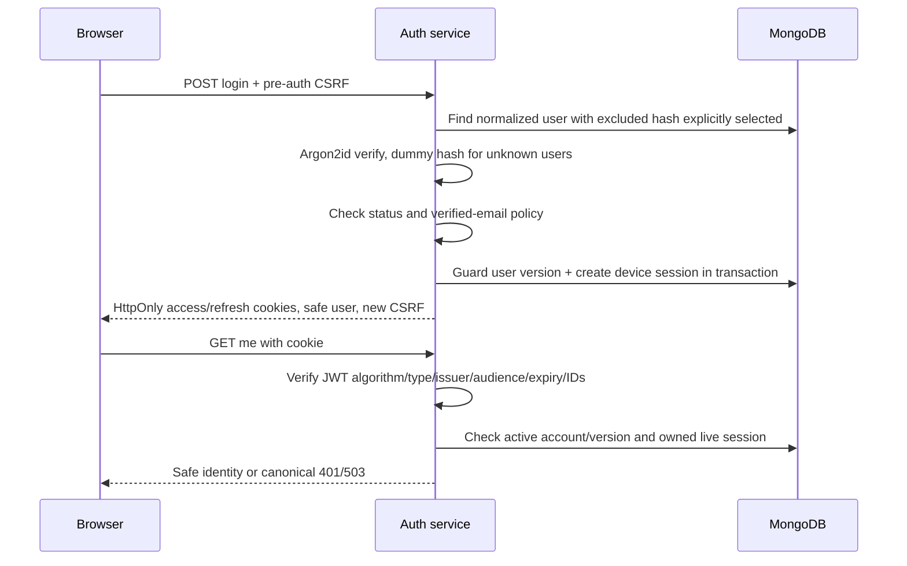
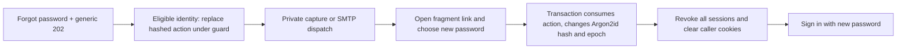
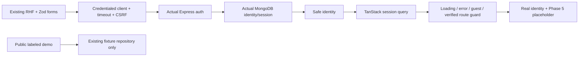

# Phase 4 · Database and authentication architecture

The implementation adds real MongoDB identity to the existing Express/React system. Development/browser tests use actual isolated MongoDB replica sets, not an in-memory auth substitute. The original Phase 4 verification recorded an Atlas URI parsing blocker and the owner's choice to continue isolated verification; see its historical [final report](phase-4-final-report.md). The November 11 follow-up below supersedes the connectivity blocker without claiming live auth-flow acceptance. Phase 5 has not started.

November 11 DNS follow-up: optional DNS_SERVERS is now validated and applied before MongoDB initialization in both process entrypoints. Typecheck, lint, all 144 backend tests, build and formatting passed; normal db:check returned connected/pingSucceeded true, and npm run dev served health/ready with HTTP 200. A read-only preflight found missing auth schema; the owner explicitly approved initializing auth collections/indexes before development startup. No user/session/token records were inserted, updated or deleted, and backend/.env was left byte-for-byte unchanged. These successful connectivity/readiness checks supersede the earlier connection blocker; the original report retains its historical results and does not become evidence of live registration/login verification.

## Boundaries and approved decisions

Root `frontend/` and `backend/` remain independent packages. The production entrypoint always requires valid database/auth configuration and connects before listening; missing dependencies never silently enable fake authentication. The application factory still supports the original infrastructure-only injected configuration for the Phase 3 tests. That test factory is not a database-free production startup path.

The latest brief supersedes the historical opaque-access choice with short-lived JWTs. Refresh/action tokens remain opaque hashes. [ADR 009](architecture-decisions/009-jwt-cookie-authentication.md) records this change, the signed session-bound CSRF implementation and route/DTO differences from historical planning. Original Phase 1–3 reports remain historical. The operational contract is [OpenAPI](../backend/openapi.json).

Registration uses `/auth/register` with name/email/password; authenticated identity uses `/auth/me`. Historical `/auth/signup` and `/users/me` plans are not aliases. Register returns a generic 202 for new/existing email instead of revealing creation through a user DTO; safe user data comes from verified login/me. No workspace, role, membership, project or subscription is created.

## Implementation map

```text
backend/src/
  config/auth-env.ts                pure validated identity/provider configuration
  lib/database.ts                  bounded connection, safe diagnostics, readiness
  lib/mail.ts                      TLS SMTP or local non-public capture
  middleware/csrf.ts                signed pre-session/session-bound nonce validation
  middleware/require-auth.ts        JWT + current database identity/session checks
  modules/users/user.model.ts       global user schema/index/serialization
  modules/auth/
    auth.models.ts                 connection-scoped models and additive indexes
    session.model.ts               one revocable device/family per document
    action-token.model.ts          verification/reset schema factory
    auth.crypto.ts                 bounded Argon2id, randomness, SHA-256, jose
    auth.schema.ts                 strict request allowlists
    auth.routes.ts                 CSRF/auth/rate/validation/controller wiring
    auth.controller.ts             cookies, envelopes, status and safe DTO mapping
    auth.service.ts                transactions, rotation, actions and mail dispatch
  commands/check-database.ts        read-only secret-free connection/ping CLI
  app.ts / server.ts               preserved composition/entrypoint boundaries
backend/tests/                     original tests plus isolated auth/guard tests
backend/scripts/test-server.ts     test-only local replica set + compiled listener
frontend/src/
  services/api-client.ts            credentialed fetch, CSRF, deadlines, refresh
  features/auth/                   forms, verification, session query and account guard
frontend/e2e/auth.spec.ts           fresh isolated backend per browser auth case
```

Routes assemble middleware, schemas and controllers. Controllers translate HTTP context and never return models/credentials. Services perform typed application operations; model access remains in this small domain-owned service/repository boundary. Models do not import HTTP. Configuration/logger/mail/time/model/connection collaborators are explicit, allowing real failure/concurrency tests without public crash or mail-inspection endpoints.

## MongoDB lifecycle and indexes

DNS startup configuration: optional `DNS_SERVERS` accepts up to eight comma-separated IPv4/IPv6 literals, trims/deduplicates them and rejects hostnames, URLs, ports, zone IDs and empty list members. Blank/omitted leaves the system resolver unchanged. Both the development/production entrypoint and the read-only database CLI validate this option and invoke the shared `configureDns` helper in the same Node process before calling `connectDatabase`. It is not enough to set DNS in a parent terminal or separate Node command. Static module imports do not open connections; MongoDB's SRV/TXT resolution begins during connection initialization after the helper runs.

The helper uses Node's process-global `dns.setServers`, including the resolver used by the driver's `dns.promises.resolve` SRV/TXT calls. It is startup-only, never reset during active queries, and does not modify OS DNS or override `dns.lookup`. Invalid values fail with field-name-only configuration diagnostics. See [Node DNS documentation](https://nodejs.org/api/dns.html#dnssetserversservers). Automated tests exercise optional/invalid/IPv4/IPv6 input and actual entrypoint ordering for development, production and db:check.

Use a dedicated Mongoose connection with command buffering and automatic indexing disabled. Server selection is bounded to 8 seconds, TCP connection to 5 seconds, socket inactivity to 10 seconds; max pool size is 10. The driver handles topology recovery. Connected/reconnected events enable dependency readiness; disconnect/error disables it. HTTP readiness also requires the listener ready and no drain. Liveness remains available while the listener exists. Operation failures normalize to safe 503s. Readiness reflects detected connection state, not an assertion that every future transaction will succeed.

At startup, create only missing declared collections/indexes using createCollection/createIndexes. Never sync/drop indexes or remove conflicting rows. A duplicate/legacy-data index conflict prevents startup and requires a reviewed migration, not automatic deletion. Transactions require a replica set: Atlas supports this; a standalone local mongod is insufficient for these auth invariants.

| Model / collection | Relationships and fields | Indexes / retention |
|---|---|---|
| User / users | Global identity: name, email, normalizedEmail, select-excluded Argon2id hash, verification/status/avatar metadata, timestamps; authVersion and write guard | Unique normalizedEmail; no tenant/membership data; no automatic user deletion |
| Session / authSessions | userId → User; hashedRefreshToken, unique tokenFamilyId, consumed hashes, authVersion, idle/absolute expiry, revoked/last-used timestamps, hashed bounded user-agent metadata | Unique current refresh hash and family; userId+revokedAt; TTL purgeAt |
| Verification / emailVerificationTokens | userId → User; hashedToken, expiresAt, consumedAt, timestamps | Unique hash; userId+consumedAt; TTL purgeAt |
| Reset / passwordResetTokens | userId → User; same action schema in a separate purpose-specific collection | Unique hash; userId+consumedAt; TTL purgeAt |



Email is trimmed and lowercased across the entire address; no provider-specific plus/dot rewriting. The database unique index handles concurrent registrations. Action hashes are SHA-256 of 256-bit random tokens; refresh hashes cover the entire session-ID/secret value. No plaintext password or raw refresh/action credential is stored. Hash fields are excluded from default selection; JSON transformations additionally remove sensitive fields. HTTP uses an explicit SafeUser allowlist, not Mongoose serialization.

Verification expires after one hour, reset after 15 minutes. Action rows purge seven days after issuance. Session purge is seven days after absolute expiry; early revocation is immediate logically, with the same bounded retained ledger. TTL is asynchronous housekeeping: all operations check expiry/revocation in queries. Consumed history stays until family purge, capped at 512 rotations; overflow revokes and requires login. At most ten active device sessions are retained; new login revokes the oldest when needed. No generic account deletion API or legal-retention claim is made.

## Signup and verification

```mermaid
sequenceDiagram
  participant B as React/browser
  participant A as Express auth
  participant D as MongoDB transaction
  participant M as Mail adapter
  B->>A: GET auth/csrf
  A-->>B: Signed nonce + HttpOnly context cookies
  B->>A: POST register + Origin + nonce
  A->>A: Strict schema, limit, bounded Argon2id
  A->>D: Unique identity + hashed verification action
  D-->>A: Commit or already-existing result
  A->>M: Track post-commit mail dispatch when eligible
  A-->>B: Generic 202; no session/workspace
  B->>A: POST verify-email with one-time token + CSRF
  A->>D: Consume token and update verification atomically
  A-->>B: Verified or safe 410
```

Passwords allow 12–128 characters, spaces and password managers; no silent truncation. A small common-password denylist supplements length checks but is not a comprehensive breached-password database. Argon2id uses 19 MiB, two iterations, parallelism one, and stores parameters in the encoded hash. A four-operation concurrency bound protects hashing resources; overflow returns 429. Production tuning and a broader compromised-password review remain release hardening work.

Verification does not log in automatically. Reusing/expiring/replacing a link returns safe 410. Resend uses a persisted 60-second guard and invalidates prior outstanding actions in the same transaction; generic responses do not reveal account eligibility.

## Login and access checks



JWT defaults to ten minutes, HS256, with a cryptographically generated environment signing key of at least 32 bytes. Claims contain sub/sid/authentication epoch/type plus standard iss/aud/iat/exp, with no password/email/role/tenant data. Signature, allowed algorithm, header/payload type, issuer, audience, subject/session formats, age and expiration are checked. The API consumes only its HttpOnly access cookie, not demo state or arbitrary client IDs/roles.

Every request checks MongoDB user/session ownership, account/verification state, epoch, expiry and revocation. A disabled account, reset or logout is rejected on subsequent requests even with an unexpired signed JWT. Unknown/incorrect/disabled login uses generic 401. Verified-email-required 403 appears only after a correct password. Dummy Argon2 verification reduces simple unknown-user timing differences; no universal constant-time network claim is made.

## Refresh rotation and concurrency

```mermaid
sequenceDiagram
  participant B as Browser client
  participant A as Refresh service
  participant D as MongoDB transaction
  B->>B: Single-flight + cross-tab Web Lock
  B->>A: Recheck me after lock; refresh only if required
  B->>A: POST refresh + HttpOnly cookie + CSRF
  A->>D: Find family, verify current hash and expirations
  A->>D: Write user guard; CAS hash; append consumed hash
  D-->>A: Commit replacement or committed replay revocation
  A-->>B: Rotated cookies + CSRF, or 401
  B->>A: Retry original protected read once
```

Default idle refresh lifetime is seven days, bounded by a 30-day absolute family lifetime. Atomic compare-and-swap and transaction retry make rotation concurrency safe. A recognized old hash revokes the entire family; an unrecognized guessed secret cannot revoke a family merely by knowing its ID. Replay revocation is committed before 401, rather than thrown inside a transaction that would roll back the security write.

Two raw simultaneous refreshes intentionally fail closed: one can return success, the replaying request then revokes that family. Frontend single-flight prevents this within one client; supported browser Web Locks coordinate tabs and recheck whether another tab already refreshed. On browsers without Web Locks, cross-tab races may require signing in again. No grace window silently makes a consumed token reusable.

Login, refresh, reset and logout-all write the user guard in transactions. Password reset/auth epoch changes therefore serialize with new credentials instead of allowing a stale password snapshot to mint a valid new session.

## Logout and reset

```mermaid
sequenceDiagram
  participant B as Browser
  participant A as Express
  participant D as MongoDB
  B->>A: POST logout + CSRF
  A->>D: Revoke owned credential family if present
  A-->>B: 204 + matching cookie clearing
  B->>B: Cancel/clear auth cache; go to login
  B->>A: POST logout-all + valid access + CSRF
  A->>D: Transaction increments user epoch and revokes all families
  A-->>B: 204 + clear cookies
```

Current-session logout is idempotent, including expired/missing credentials, but still requires valid CSRF/context. Logout-all requires authentication. Safe clearing uses the exact cookie path/security/SameSite attributes. A network failure does not falsely report server-side revocation; the UI offers retry. All-device revocation remains authoritative on the server even if another tab holds stale display data until its next check.



Reset and verification tokens are purpose-separated, expire explicitly and can be consumed once. Parallel consumption commits once. Tokens never appear in production responses/logs. Mail links use `#token=...` so HTTP URL/referrer requests do not carry them; React stores the fragment transiently and replaces the URL. Mutation requires an explicit form/button action, not a GET that email scanners can accidentally consume.

## Cookies, CSRF, CORS and logging

Production cookies use `__Host-fw_access`, `__Host-fw_refresh`, `__Host-fw_csrf` and `__Host-fw_pre`: Secure, HttpOnly, SameSite=Lax, Path=/, no Domain. Local HTTP uses separate `fw_*` names and disables Secure only outside production. Access Max-Age matches its lifetime; refresh Max-Age never exceeds the current idle/absolute bound. Security attributes are derived from NODE_ENV rather than a production-disable toggle.

CSRF bootstrap returns a one-hour signed nonce bound to the HttpOnly pre-session secret or refresh session ID. The HMAC key is domain-separated from the JWT key. Every unsafe auth request requires a matching cookie/header, valid signature/time, exact configured Origin and non-cross-site Fetch Metadata. Constant-time comparisons verify signed values. Login/refresh rotate the nonce. No-Origin unsafe requests are rejected; non-browser scripts must deliberately supply an approved Origin and the bootstrap cookie/header flow.

Credentialed CORS is enabled only for the real auth runtime, with the existing exact allowlist and X-CSRF-Token allowed. No wildcard is used. Development browser/API must use the same host spelling; localhost and 127.0.0.1 are different cookie sites. Production supports same-origin/same-site HTTPS, not unrelated-site cookies. CORS is not authentication and SameSite is not the entire CSRF defense.

Existing Helmet, request IDs, safe route-template Pino logging, JSON caps, no-store, API limits and `trust proxy=false` remain. Credential/action endpoints share 20 attempts/15 minutes/IP in addition to the API limit; resend/recovery issuance has a persisted 60-second account guard. Limits are process-local and need reviewed shared/edge enforcement before replicas or substantial public exposure. Behind a proxy today, clients can share an IP budget; never blindly trust forwarded headers to fix this.

Log serializers exclude URLs/query strings/bodies/cookies/Authorization/raw exception messages and model/token data. Database diagnostics expose a static category, never URI, hostname or credentials. Mail errors expose a static code. Request IDs correlate safe errors and completion logs.

## Mail and local execution

Development/test capture writes local JSON files under ignored `backend/.mail-capture/` with requested private file modes; Windows directory ACLs remain the host's responsibility. It exposes no HTTP mailbox endpoint and sends no real email. Open the relevant local file privately to use its link; do not upload/share these files. Production forbids capture and requires TLS SMTP. Dispatch follows the committed action, is tracked for shutdown, and is not awaited by the generic public response. SMTP acceptance alone is not delivery; no acceptance/delivery claim is made by 202. Failures log a static code and can be retried through resend/recovery after throttling. There is no durable outbox: a crash can require a new request.

Preserve the existing .env. Only the missing signing key was appended locally; original bytes/credentials were retained and no secret was printed. Required config: MONGODB_URI/JWT_SECRET plus the existing production origin policy. Optional bounded token/issuer/audience/provider configuration is documented in `.env.example`. Production additionally requires MAIL_MODE/SMTP configuration; backend variables never use the VITE prefix.

```powershell
Set-Location C:\FLOWWORKAI\backend
npm.cmd install
npm.cmd run build
npm.cmd run db:check
# Continue only after the private database configuration is valid.
npm.cmd run dev
```

`db:check` performs connection/ping only and prints booleans/static error codes. A DATABASE_URI_INVALID result requires privately correcting URI format/options in .env; no Atlas user/network change or credential replacement was performed here. The owner chose isolated verification while this remains unresolved.

For a new environment missing JWT_SECRET, this command appends one cryptographically generated key without printing it or changing existing assignments:

```powershell
node --env-file-if-exists=.env -e "const fs=require('node:fs'),crypto=require('node:crypto');if(!process.env.JWT_SECRET&&!/^JWT_SECRET\s*=/m.test(fs.readFileSync('.env','utf8')))fs.appendFileSync('.env','\nJWT_SECRET='+crypto.randomBytes(32).toString('hex')+'\n')"
```

Do not use an empty/placeholder key as production configuration. Existing invalid assignments must be corrected privately rather than overwritten by automation. Native Node env-file loading gives existing process variables precedence. `npm start` still forces production.

```powershell
Set-Location C:\FLOWWORKAI\frontend
npm.cmd install
npm.cmd run dev
```

Development defaults choose the matching localhost/127.0.0.1 API host on port 5000. Mail links use the first FRONTEND_ORIGIN, so put the canonical browser host first. VITE_API_BASE_URL is the only public frontend connection setting. Production defaults to `/api/v1` on the same origin; configure an explicit same-site HTTPS URL when needed. Sign up, open captured verification, confirm, sign in and view `/account`. No company/workspace is provisioned. Explore Demo Workspace remains available without the backend and never persists demo records to MongoDB.

## Frontend flow and test safety



Session state has one owner: the TanStack Query auth key. No duplicate persisted Zustand session or localStorage credential is introduced. Protected entry checks me, attempts a bounded refresh if 401, then retries once. It shows a loading/error state before private content; network failure does not masquerade as a verified user. Logout cancels/clears cached identity only after server confirmation. Redirects are fixed internal paths, avoiding user-controlled open redirects. The existing UI store still owns theme/sidebar preferences.

Vitest auth fixtures generate their own loopback replica set/database name and random signing key without reading .env/MONGODB_URI. Cleanup requires test environment, exact generated `flowwork_test_*` name and matching loopback URI/connection host. Production/remote/unnamed cleanup configurations are rejected. No destructive test operation is issued to Atlas.

Playwright builds the backend and a separately compiled test orchestrator. Each auth case launches the real compiled server against a fresh isolated replica set; it does not disable CSRF, cookies or rate controls. Test mail is read from local capture for controlled accounts. The older UI-only invalid-login assertion uses a scoped response fixture; separate auth browser tests exercise actual HTTP/database flows. Existing desktop/mobile demo/navigation/accessibility checks remain. Generated test/runtime/mail/trace artifacts are ignored. See the report for actual executed counts and failures/limits rather than assuming the historical numbers.

## Phase 5 extension points and remaining limits

Require explicit authorization before workspace/membership/RBAC work. Use the server-derived AuthContext user identity as input to future tenant resolution; never trust client roles, demo user IDs or JWT role claims. Add scoped repositories and resource policy before business data. Current `/account` is an honest identity/onboarding placeholder; demo workspace cards remain fictional.

Live Atlas connection/ping and development readiness passed in the DNS follow-up; controlled live auth-flow verification remains separate. Production SMTP/hosting/TLS, shared rate enforcement, operational secret rotation, monitoring/retention, password-screening/tuning and deployment review are prerequisites for exposure, not claims of completed deployment. No workspace CRUD, Socket.IO, AI/RAG, payments, uploads or Phase 5 collection exists.
