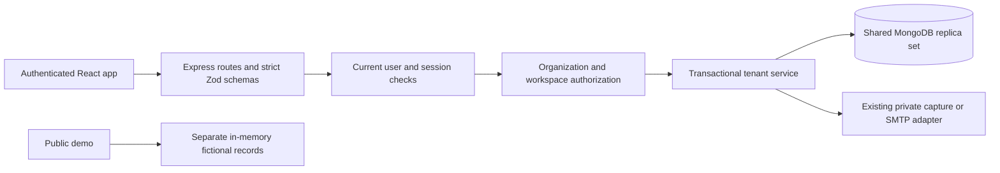
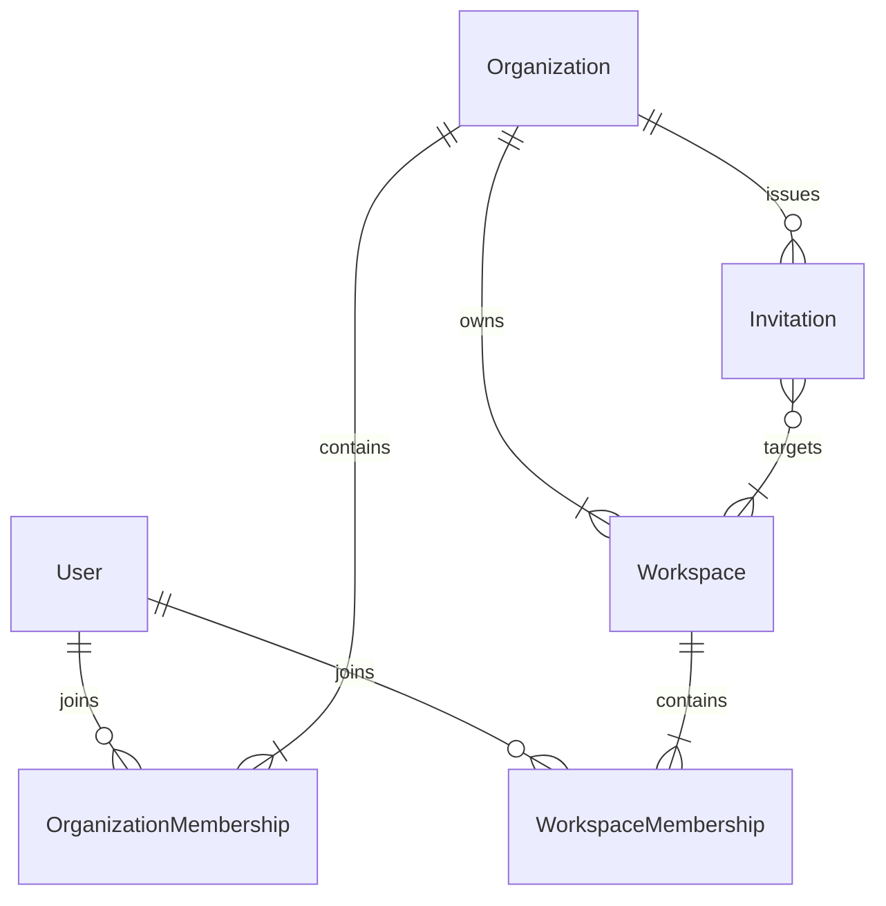
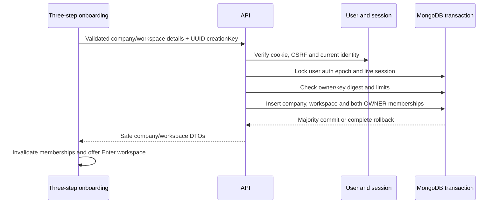

# Phase 5 multi-tenant architecture

Status: implemented locally; live rollout is pending private credential rotation and explicit additive schema initialization. Historical Phase 1–4 reports retain their original scope. Phase 6 is not implemented.

## Product and boundaries

A verified account can create a real company, create workspaces, invite teammates and manage current memberships. Organization is the company boundary; workspace is its child scope. IDs are immutable MongoDB identifiers, never interchangeable slugs. One shared database contains tenant-scoped collections. Public `/w/studio`, `/w/lab`, `/workspaces` and `/onboarding` remain fictional demos; real account journeys use `/app`.



## Collections and relationships



`organizations`: normalized name/slug, optional website/industry/description, immutable ownerUserId, active/archived status, revision and creation key/digest. Unique global normalized slug and owner/creationKey.

`workspaces`: immutable organizationId, creator, name/slug/description, active/archived status and revision. Unique organization/slug and organization/creator/creationKey. Identical workspace slugs are allowed across companies.

`organizationMemberships`: immutable organization/user, OWNER/ADMIN/MEMBER, active/revoked, joinedAt and timestamps. Unique organization/user. User/status/_id index supports current membership pagination. Partial unique organization/OWNER index allows exactly one active founding owner when combined with the transaction and immutable-owner policy.

`workspaceMemberships`: organization/workspace/user, OWNER/ADMIN/MANAGER/MEMBER/VIEWER, active/revoked and timestamps. Unique workspace/user, organization/user/status and partial unique active workspace/OWNER indexes. The service derives workspace parents and checks both tenant identifiers before every write; arbitrary relationship construction is not exposed over HTTP.

`invitations`: organization, normalized email, intended company role, 1–10 workspace-role targets, issuer, SHA-256 tokenHash, status, expiration, last-send, acceptance/revocation timestamps, optional message and purgeAt. Unique tokenHash and partial unique pending organization/email; organization/status/_id and email/status/expiry query indexes. A 90-day purge TTL is housekeeping; every preview/accept checks the 72-hour business expiry directly. Documents and DTOs never serialize the token hash. Raw tokens occur only in private action links/mail capture and process memory.

Models disable automatic index/collection creation. `tenantIndexesReady` checks key, unique, partial filter and TTL metadata read-only. `schema:tenants -- --rotation-confirmed` creates declared collections/indexes additively; it does not insert business examples, drop indexes or alter records. Never invoke it before privately rotating compromised credentials. Test bootstrap creates schema only in generated isolated databases. Normal live startup fails closed if tenant schema is missing.

## Explicit permission policy

Authentication proves an active verified identity and live session. Authorization queries current database membership; roles are not taken from JWT claims or request bodies. An active organization membership is required for every workspace. A pending invite grants nothing.

| Capability | Org OWNER | Org ADMIN | Org MEMBER | Workspace OWNER / ADMIN | Workspace MANAGER / MEMBER / VIEWER |
|---|---|---|---|---|---|
| Read own company | yes | yes | yes | through company membership | through company membership |
| Company settings | yes | yes, status excluded | no | no | no |
| Archive/restore company | yes | no | no | no | no |
| Create workspace | yes | yes | no | no | no |
| Company directory/invitation list | yes | yes | no | no | no |
| Company member management | non-owner, non-self | MEMBER targets only | no | no | no |
| Workspace read and directory | inherited all company workspaces | inherited all company workspaces | explicit membership | scoped workspace | scoped workspace |
| Workspace settings/archive | inherited | inherited | no implicit grant | yes | no |
| Workspace invitations/team | inherited | non-admin grants | no implicit grant | yes, ADMIN cannot grant/touch ADMIN | no |
| Grant organization ADMIN | yes | no | no | no | no |
| Grant workspace ADMIN | yes | only when actual workspace OWNER | no | OWNER only | no |
| Change/remove founding owner | no | no | no | no | no |

The centralized executable matrices are `backend/src/modules/memberships/permissions.ts`; target-role and self/owner restrictions are additionally enforced in the service. A workspace OWNER may be a company MEMBER. Company OWNER and ADMIN have explicitly inherited authority; effective workspace role is OWNER for company OWNER and ADMIN for company ADMIN unless that account is the actual workspace OWNER. Company admins cannot bypass founding-owner protection.

This extends the earlier workspace-only tenant plan with a company parent. MANAGER remains read-only for current settings/team operations; future project-specific capabilities are deferred. One immutable founding owner is a deliberate Phase 5 restriction. Ownership transfer and multiple owners are deferred, never simulated. There is no delete-company/workspace endpoint; archive/restore is reversible. Archived companies conceal ordinary members; archived workspaces conceal ordinary workspace roles. Authorized administrators retain read/restore access, with company restoration required before child mutations.

## Atomic onboarding and retries



Double clicks share one UUID. Same actor/key and payload return the existing result; changed details with a reused key conflict. Unique indexes and user document locking handle simultaneous submissions. Onboarding fails atomically if any founding record fails. Workspace creation also inserts its OWNER in the same transaction. Limits: ten owned companies/account, 100 active company memberships/account, twenty workspaces/company, 1,000 active company memberships/company and 1,000 pending invitations/company. Lists default to twenty, maximum fifty; stable ObjectID cursors bound responses.

## Tenant context, isolation and concurrency

```mermaid
sequenceDiagram
  participant Client
  participant Route
  participant Identity
  participant Tenant as Tenant middleware/service
  participant DB
  Client->>Route: Cookie and resource ID
  Route->>Identity: Validate current user/session
  Route->>Route: Strict body, params and query schemas
  Route->>Tenant: Resolve organization/workspace and permission
  Tenant->>DB: Query active organization + workspace memberships
  DB-->>Tenant: Current roles
  Tenant-->>Route: Authorized scope or concealed 404 / permitted-scope 403
  Route->>Tenant: Scoped operation; mutation reauthorizes in transaction
```

Unknown IDs and unrelated scopes return the same resource-unavailable 404. Related users lacking a capability receive 403. Validated middleware context is a convenience, never a substitute for service authorization. Read operations scope every query to authorized identifiers; the only unscoped workspace lookup reads its parent ID before authorization and does not return resource content.

Every tenant mutation starts a snapshot transaction, locks the actor's current auth epoch/user document and active session document (incrementing its internal version). It reauthorizes current membership inside the transaction and increments the shared organization revision. This serializes competing membership, invite, archive and acceptance changes. Auth logout/disable/epoch changes contend on the same user guard. MongoDB retries transient transaction conflicts; duplicate unique keys produce a safe 409. Settings use explicit optimistic versions to reject stale edits. Removing a company membership revokes its workspace memberships atomically; users owning a child workspace cannot be removed. Ownership is never writable through role schemas.

Lists batch user lookups rather than querying one user per member. Membership caps bound workspace membership lookups. Larger tenants may need aggregation/materialized access and cursor refinements, measured before introducing caching. No Redis or queue was added. Email dispatch happens after commit and is tracked for graceful shutdown; failure logs only a category, and an authorized resend replaces the token. There is no durable outbox yet, so process termination between commit and send requires manual resend.

## Invitations

Authorized callers choose a normalized email, company role and valid same-company workspace targets. Organization ADMIN cannot grant ADMIN; workspace administrators can grant only within scopes they administer. Workspace-scoped lists expose single-target invitations only to avoid leaking other workspace names or roles; company admins manage multi-target invitations centrally. Issuance is limited to twenty per IP/hour across invitation create/resend/revoke/preview, in addition to existing global API limits. Resend requires a sixty-second cooldown and invalidates the previous link. Expired invitations require new issuance. Duplicate pending company/email returns 409. Acceptance preserves existing active memberships and their roles; a later invite cannot silently upgrade them. Revoked memberships can be reinstated through authorized fresh invitations.

```mermaid
sequenceDiagram
  participant Owner
  participant API
  participant Mail as Capture or SMTP
  participant Invitee
  participant DB
  Owner->>API: Invite verified email to scoped roles
  API->>DB: Authorize targets; store only random token hash
  API->>Mail: Private fragment link after commit
  Mail-->>Invitee: Company/workspaces, roles, expiry and action link
  Invitee->>API: POST minimal token preview
  Invitee->>Invitee: Sign in, or register and verify matching email
  Invitee->>API: Explicit accept with token + CSRF
  API->>DB: Transaction: verify identity/email, pending expiry, issuer permissions
  API->>DB: Create/reinstate memberships and consume invitation once
  DB-->>Invitee: Authorized workspace destination
```

The invitation route removes the fragment from browser history and holds continuation in module memory only. No raw token is stored in localStorage/sessionStorage, query keys or logs. SPA sign-in resumes acceptance. Registration or verification in another tab/full navigation can clear memory; reopen the original private invitation after verification/sign-in. Preview returns only company name, workspace names/roles and expiry, never the recipient address or unrelated tenant data. Acceptance is explicit; wrong email fails, replay fails, and concurrent acceptance commits once. The issuer must still have authority at acceptance time; its active verified user record is locked during acceptance as well.

Capture uses the existing `backend/.mail-capture` private directory, not an HTTP mailbox viewer. Open only the intended local capture JSON privately in the IDE and follow its action link. Do not paste its contents or token into reports. SMTP uses existing validated configuration and production disallows capture. Tests read only their uniquely generated recipients; no existing private message is printed.

## Frontend and switching

Real routes: `/account`, `/app`, `/app/workspaces`, `/app/onboarding`, `/app/w/:workspaceId/overview`, `/app/w/:workspaceId/team`, `/app/w/:workspaceId/settings`, `/app/organizations/:orgId/settings`, `/app/organizations/:orgId/team`. `/app/invitations` permits a token-scoped public preview and requires verified login before acceptance. The old demo onboarding route remains intact.

```mermaid
sequenceDiagram
  participant User
  participant Router
  participant Cache as TanStack Query
  participant API
  User->>Router: Choose authorized workspace ID
  Router->>Cache: Cancel old tenant queries; remove old workspace cache
  Router->>API: Fetch context under current user + workspace query key
  API->>API: Verify current database memberships
  API-->>Router: Authorized DTO or unavailable
  Router->>User: Mount new shell only after authorization
```

User/workspace IDs scope all tenant cache keys. No previous-data placeholders are used. Logout cancels and clears the whole query cache and invitation continuation. Context refetches on mount and every ten seconds; mutation authorization is immediate on the backend. URL IDs provide safe restoration after reload because access is revalidated. The directory supports cursor pagination; the quick switcher shows the first fifty choices, with All workspaces for later pages. ThemeMenu reuses existing light/dark/system state. Current settings, member counts, invitations and roles come from MongoDB; future projects/tasks/support/analytics/AI show explicit empty states.

## Safe rollout and reproducible demonstration

1. Privately rotate the previously disclosed Atlas password and JWT signing secret; update local/deployment configuration yourself. The agent has not edited `.env` or used the IDE token.
2. In backend, run build and read-only `npm.cmd run db:check`. Optional DNS_SERVERS is parsed/validated and configured in the same process before any MongoDB SRV/TXT lookup for dev/start/check/schema commands.
3. After rotation, explicitly run `npm.cmd run schema:tenants -- --rotation-confirmed`. This is additive schema initialization; no company/member fixtures are inserted.
4. Start backend and frontend using their existing dev scripts. Register and verify controlled accounts with private capture links. Create Hans Solar / Solar Operations and Creative Agency / Client Projects through `/app/onboarding`.
5. Invite a controlled second account as MEMBER, verify matching email, accept, change to VIEWER, demonstrate settings denial and membership removal. Give a controlled account memberships in both companies and switch. An unrelated account must receive 404 on either company's copied workspace ID.
6. Sign out and confirm protected routes redirect. Explore Demo Workspace separately. Never use production/Atlas cleanup scripts for this demonstration.

Automated tests use generated loopback replica sets, random signing keys and controlled addresses, without loading `.env`. Full-stack tests exercise the compiled actual server and existing mail adapter. See the final report for commands, actual counts and remaining live blockers.

## Future integration boundary

Phase 6 may add tenant-scoped projects/tasks only with new authorization. Reuse resolved organization/workspace IDs, current membership checks, strict schemas, compound indexes and transactional guards. Do not accept a client-supplied tenant foreign key without resolving and authorizing its parent. Sockets, jobs, exports, downloads and AI retrieval will each need the same live membership checks. None of those modules is implemented in Phase 5.

