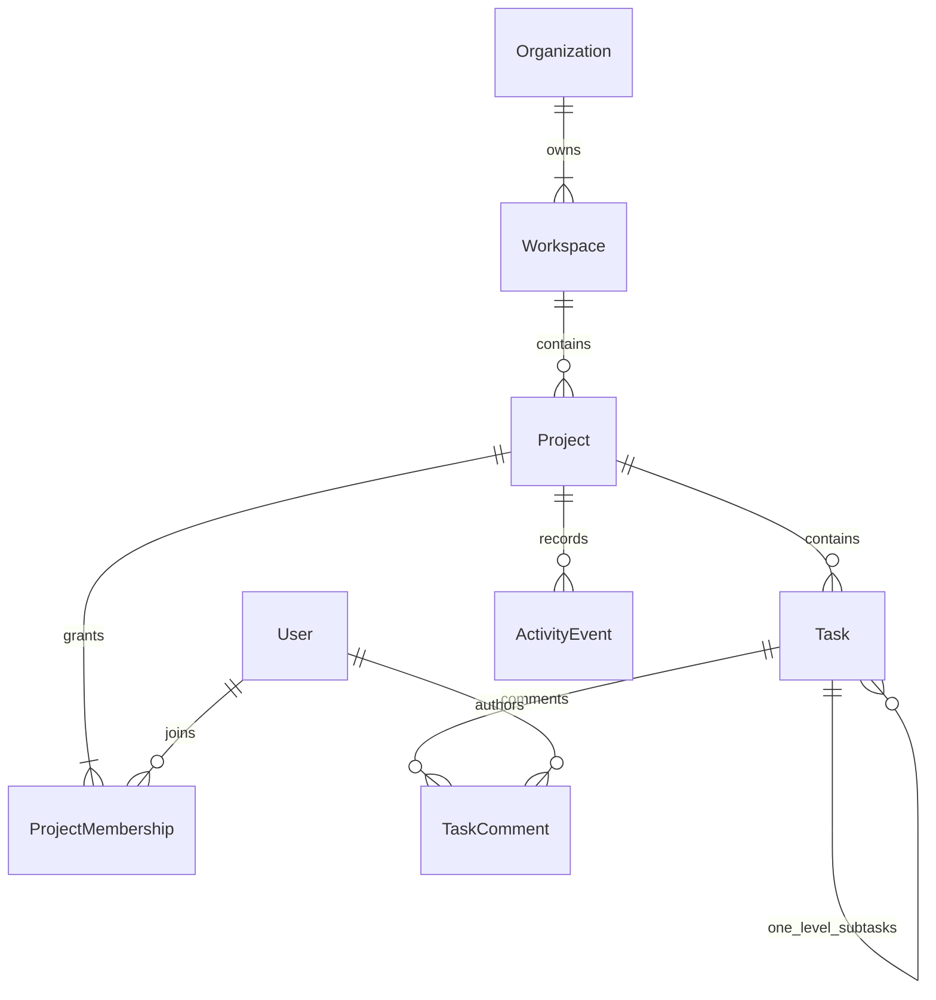
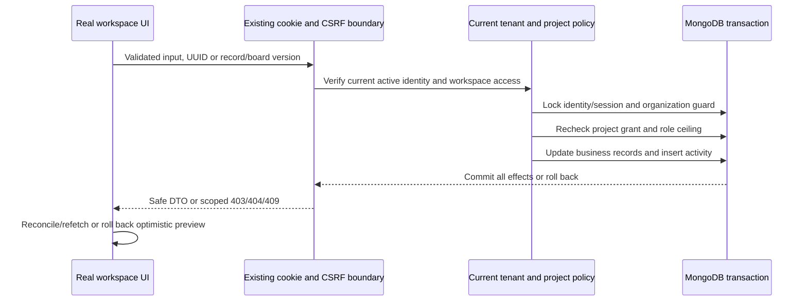

# Phase 6 repository audit and design

November 12, 2026. The new brief explicitly authorizes Phase 6; earlier Phase 5 stop rules are historical. No Phase 7 work is authorized.

Existing: Node/Express strict TypeScript modular monolith, Mongoose transactional identity/tenant services, current DB RBAC, signed CSRF, sanitized errors/logging, optional startup DNS, isolated replica-set fixtures; React Router, TanStack Query, RHF/Zod, Radix primitives and dnd-kit. Authenticated /app workspace routes use real Phase 5 DTOs. Public /w demo project/task/Kanban pages use an in-memory repository and stay independent.

Reuse: authentication, cookie/CSRF API client, tenant context and transaction guards, UI components/styles, query cache lifecycle, dnd-kit, actual compiled-server Playwright harness. New persistence: projects, projectMemberships, tasks (one-level parent reference), taskComments, activityEvents. No client/files/socket/chat integration is added.

Authorization: company/workspace OWNER/ADMIN administer all projects within their current workspace authority. Workspace MANAGER may create projects and manage a project only with its MANAGER grant (or as owner). MEMBER may contribute only to explicit projects; VIEWER remains read-only even with a forged stronger grant. Grants never replace current company/workspace access. Project ownership transfer requires an eligible active non-viewer manager/admin; owner membership cannot be removed before transfer. Assignment requires active verified account and current project/workspace/company eligibility. Comments are plain text; only their author or a project administrator may edit/delete. Archived projects and tasks are read-only except authorized restoration. Parent archive conceals its subtasks from active lists; child completion does not automatically complete the parent.

Concurrency: reuse Phase 5 transaction identity/session locks and organization guard; reauthorize in each transaction and lock project revision. Versioned project/task/comment edits reject stale updates. UUID creation keys prevent duplicate retries. Task ordering uses indexed integer gaps; normal moves touch one task, with transactional two-pass rebalance only when gaps exhaust. Project board revision rejects concurrent stale ordering. Per-column board pages are bounded and have explicit next cursors. Tasks/activities commit together, with actor and safe metadata produced only by the server.

Contracts: one backend status/label/priority configuration is exposed by authenticated API and used to render real frontend forms/columns. Stable codes distinguish authenticated API data from historical demo enums. Lists use validated filters, bounded pagination and stable sort. Dashboard uses scoped aggregation over accessible projects, not a browser-wide task fetch. Schema readiness is read-only at normal startup; tests provision isolated schemas. A separate reviewed schema command/plan will not run on Atlas during this task.

Regression risks: extended permission lists require semantic updates to exact-matrix tests; OpenAPI path inventory expands; old auth fixtures must remain auth-only unless opted into projects. The original public demo and auth browser cases remain. Pending: rotation, Phase 5 live schema and real onboarding, separately approved Phase 6 live schema and manual acceptance.

## Persistence map

## Authorized mutation flow

Automatic test schema creation is additionally restricted at the actual server entrypoint to an exact generated loopback namespace, before any schema setup. NODE_ENV=test alone cannot provision Atlas. A read-only live metadata audit on November 12 found both declared Phase 5 and Phase 6 schema readiness false; this means their required sets do not yet match the application's requirements, not that every collection is necessarily absent.
