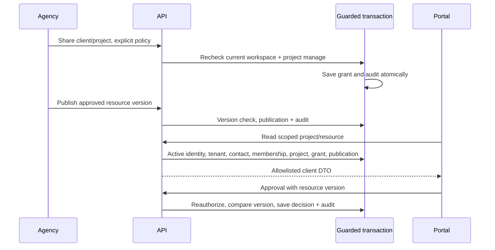

# Phase 7 audit and implementation design

The Phase 7 brief supersedes the earlier Phase 6 stop rule. Stop before Phase 8. Preserve private environment files and the independent public demo. No Atlas writes are authorized.

Reuse Express/Zod, existing verified identity and cookie/CSRF/refresh, tenant transaction identity/session locks and organization guard, Phase 6 project capabilities, private development mail capture, React Router/Query and shared UI components. Existing client list/detail and portal project/milestone/feedback pages are fictional in-memory previews; no production client authorization exists there.

Implement seven collections: clients, clientContacts, portalMemberships, portalInvitations, clientProjectGrants, clientResources and clientAuditEvents. Resources use a discriminated kind for progress, milestone, feedback, reply, change and deliverable; each query includes the client/project/tenant scope. Revisioned deliverables are separate records; prior decisions survive supersession. Plain-text replies are separate paginated records, not unbounded arrays.

Internal OWNER/ADMIN manage CRM and portal access. Project management permission additionally gates project sharing/publication and review. Portal membership is separate from employee membership; CLIENT_ADMIN and CLIENT_MEMBER may contribute only when the grant allows it, CLIENT_VIEWER is read-only. Representative management requires explicit agency permission and cannot grant CLIENT_ADMIN. No portal action creates internal memberships.

External reads recheck active company/workspace/client/membership/project/grant. Dedicated allowlisted DTOs never serialize internal projects, tasks, comments, assignments or activity. Only explicitly approved title/description and published collaboration resources appear. Grant policy independently controls progress, milestones, deliverables, feedback, changes and approval. All mutations reauthorize inside guarded transactions and append safe audit events atomically. Optimistic versions and UUID create keys protect retries and races.

Execution: models/contracts, transactional services and routes; safe schema plan/startup gate; internal CRM and project collaboration UI plus external portal/invitation flow; isolated integration/browser/accessibility and regressions; final report. Schema command defaults to a static read-only plan; live apply needs private rotation and separate approval for the intended environment, with Phase 5/6 prerequisites ready.

## Data and requests

`clients` contains agency-owned CRM details, lifecycle, account owner, tags and representative-management policy. `clientContacts` keeps normalized addresses and one active primary contact. `portalMemberships` uniquely joins client/user, referencing a contact without creating employee access. `portalInvitations` stores only random token hashes, email binding, issuer, role, explicit expiry and state. `clientProjectGrants` uniquely joins a client/project and holds approved title/description plus six independent visibility/action switches. `clientResources` uses immutable kind for progress, milestone, feedback, reply, change and deliverable. `clientAuditEvents` records server-owned actions without messages, links, tokens or private email contents.

Indexes include unique client create retries, normalized client/contact email, partial unique active primary contact, client/user membership, invitation hash and pending client/contact, client/project grant, resource create retry and unique deliverable predecessor. Tenant/client/project/kind/publication cursor indexes serve lists; additional position and due-date indexes serve milestones. The static schema command prints exact declarations. No existing migration framework performs automatic business migration; initialization creates collections and declared indexes additively.

Lists default to 20 and cap at 50. CRM supports literal escaped search, lifecycle and oldest/newest sorting. Resource lists are client/project/kind scoped; milestone display-order sorting has a position/ObjectId cursor. Audit and replies use bounded pages. Caps: 10,000 clients/workspace, 1,000 contacts/client, 1,000 project grants/client and 10,000 collaboration records/client/project. Portal membership choice pages reauthorize at most 50 records; this bounded loop is intentional, not an unbounded global scan. Dashboard grant aggregation is bounded by the client grant cap and returns at most five recent updates, ten upcoming milestones and five recent feedback records. Actual files are never fetched or stored.

## Transition policy

| Kind | Agency transitions | Client actions |
|---|---|---|
| Progress | draft -> published -> superseded/archived | Published read only |
| Milestone | planned/in_progress/completed/delayed, archive, explicit publication, edit display order | Published read only |
| Feedback | open -> acknowledged/resolved/closed; resolved -> open/closed | Create and edit own open feedback; shared thread replies |
| Change | submitted -> under_review -> approved/rejected; approved -> completed | Submit; read client-safe decision summary |
| Deliverable | draft -> shared; later superseded/archived; replacement is a new draft version | Shared -> approved/changes_requested, explicit approval grant and non-viewer role |
| Reply | Plain-text record, explicit agency publication | Create/read in authorized shared feedback thread |

An agency cannot impersonate a client approval. Approved deliverable content is immutable; replacement creates a new revision and preserves the predecessor's decision. Change approval may link a current same-project task in the same guarded update; later linking remains separately authorized. Task identifiers, employees and internal content are excluded externally. A client status other than active, an archived tenant/project, a revoked grant/membership or an archived contact blocks portal access. Restore is explicit and does not delete related records.

## Identity and delivery

Invitations reuse 256-bit random tokens and SHA-256 hashing from existing auth utilities. Expiry is configurable per invitation, 1-168 hours with 72-hour default. Acceptance requires matching verified email, live session, current issuer authorization, active contact and client, and consumes once in a transaction. Pending client/contact invites are unique. Resend has a 60-second cooldown, preserves expiry and replaces the token. Existing active membership roles are never upgraded by acceptance. Invitation operations are limited to 20/IP/hour in normal runtime, in addition to the unchanged general API limit. The isolated server alone uses a larger general request budget after enforcing its generated loopback database guard, to permit accelerated two-user browser scenarios.

Mail dispatch follows commit and logs a static failure category. The existing private capture directory remains the development transport. No Gmail/SMTP delivery was claimed. There is no durable outbox: process termination before send requires authorized resend. Portal token continuation exists in module memory only, clears on logout, and never goes into query keys or browser storage. A full reload or registration/verification in another tab may require reopening the original private invitation.

## Frontend behavior

Internal client pages use existing tenant shell and UI tokens. The external portal has separate navigation and no employee workspace menu. Shared API transport handles cookies, CSRF and refresh. Each query key contains the current identity and scoped API path. Context switches cancel/remove old caches; fresh queries gate mounting, failed authorization hides stale content. Ten-second polling checks current authorization while a page is open; backend revocation is immediate for subsequent requests, while already rendered information cannot be recalled instantaneously. Section selection is in the URL, so a reload retains collaboration context. Creation forms retain UUID retry keys after uncertain failures.

Forms use React Hook Form, accessible labels/errors and server Zod validation. External links use HTTPS and noopener/noreferrer. Strings render as text. No uploads, object-store ACLs, signed URLs, billing, tickets, sockets or AI behavior is simulated as production functionality.

